# WORLDSEED Biome Atlas

Generated from the current terrain, resource, species, fish, crop, and visual catalogs. Entries describe eligible spawns, not guaranteed presence; climate, season, density, deterministic placement, and simulation state still apply.

A ★ marks an entry that is eligible in only one atlas biome group. This atlas does not invent missing aquatic wildlife/resource definitions.

## Grassland

Open temperate land. Resource and wildlife eligibility still depends on climate fields.

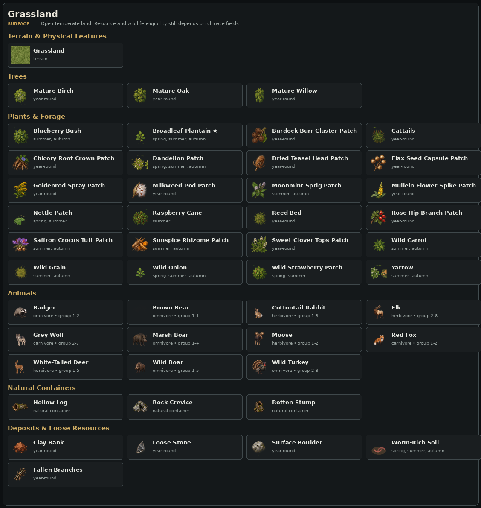

### Terrain and physical features

| Terrain | Runtime ID | Feature |
|---|---|---|
| Grassland | core:grass | terrain |

### Trees

| Feature | Seasons | Density | Yields |
|---|---|---:|---|
| Mature Birch | year-round | 180 | Bark x2-3, Wood x2-5 |
| Mature Oak | year-round | 420 | Bark x1-2, Wood x4-7 |
| Mature Willow | year-round | 120 | Bark x2-4, Branch x1-2, Wood x2-4 |

### Plants and forage

| Feature | Seasons | Density | Yields |
|---|---|---:|---|
| Blueberry Bush | summer, autumn | 120 | Blueberries x2-5 |
| Broadleaf Plantain ★ | spring, summer, autumn | 55 | Plantain x1-3 |
| Burdock Burr Cluster Patch | year-round | 60 | Burdock Burr Cluster x1 |
| Cattails | year-round | 105 | Cattail Root x1-2, Reeds x1-2 |
| Chicory Root Crown Patch | year-round | 60 | Chicory Root Crown x1 |
| Dandelion Patch | spring, summer, autumn | 110 | Dandelion x1-3 |
| Dried Teasel Head Patch | year-round | 60 | Dried Teasel Head x1 |
| Flax Seed Capsule Patch | year-round | 60 | Flax Seed Capsule x1 |
| Goldenrod Spray Patch | year-round | 30 | Goldenrod Spray x1 |
| Milkweed Pod Patch | year-round | 60 | Milkweed Pod x1 |
| Moonmint Sprig Patch | summer, autumn | 8 | Moonmint Sprig x1 |
| Mullein Flower Spike Patch | year-round | 60 | Mullein Flower Spike x1 |
| Nettle Patch | spring, summer | 80 | Brush x1-2, Nettle x1-3 |
| Raspberry Cane | summer | 90 | Raspberries x2-4 |
| Reed Bed | year-round | 220 | Reeds x2-5 |
| Rose Hip Branch Patch | year-round | 30 | Rose Hip Branch x1 |
| Saffron Crocus Tuft Patch | summer, autumn | 8 | Saffron Crocus Tuft x1 |
| Sunspice Rhizome Patch | summer, autumn | 8 | Sunspice Rhizome x1 |
| Sweet Clover Tops Patch | year-round | 30 | Sweet Clover Tops x1 |
| Wild Carrot | summer, autumn | 55 | Wild Carrot x1-2 |
| Wild Grain | summer, autumn | 80 | Wild Grain x1-3 |
| Wild Onion | spring, summer, autumn | 65 | Wild Onion x1-3 |
| Wild Strawberry Patch | spring, summer | 70 | Strawberries x1-4 |
| Yarrow | summer, autumn | 50 | Yarrow x1-3 |

### Animals

| Animal | Diet | Group | Climate-limited |
|---|---|---:|---|
| Badger | omnivore | 1-2 | yes |
| Brown Bear | omnivore | 1-1 | yes |
| Cottontail Rabbit | herbivore | 1-3 | yes |
| Elk | herbivore | 2-8 | yes |
| Grey Wolf | carnivore | 2-7 | yes |
| Marsh Boar | omnivore | 1-4 | yes |
| Moose | herbivore | 1-2 | yes |
| Red Fox | carnivore | 1-2 | yes |
| White-Tailed Deer | herbivore | 1-5 | yes |
| Wild Boar | omnivore | 1-5 | yes |
| Wild Turkey | omnivore | 2-8 | yes |

### Natural containers

| Feature | Seasons | Density | Yields |
|---|---|---:|---|
| Hollow Log | year-round | 26 | — |
| Rock Crevice | year-round | 16 | — |
| Rotten Stump | year-round | 20 | — |

### Deposits and loose resources

| Feature | Seasons | Density | Yields |
|---|---|---:|---|
| Clay Bank | year-round | 60 | Clay x1-3 |
| Loose Stone | year-round | 160 | Stone x1-2 |
| Surface Boulder | year-round | 140 | Stone x2-5 |
| Worm-Rich Soil | spring, summer, autumn | 45 | Earthworms x2-5 |
| Fallen Branches | year-round | 170 | Brush x1-2, Branch x1-2 |

## Forest & Thickets

Wooded terrain and legacy berry-thicket ground. Forest wildlife also treats berry thickets as forest habitat.

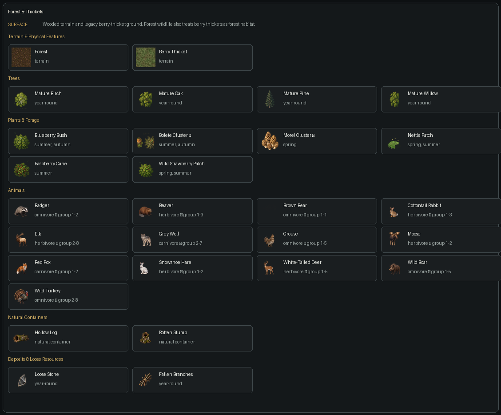

### Terrain and physical features

| Terrain | Runtime ID | Feature |
|---|---|---|
| Forest | core:forest | terrain |
| Berry Thicket | core:berry_thicket | terrain |

### Trees

| Feature | Seasons | Density | Yields |
|---|---|---:|---|
| Mature Birch | year-round | 180 | Bark x2-3, Wood x2-5 |
| Mature Oak | year-round | 420 | Bark x1-2, Wood x4-7 |
| Mature Pine | year-round | 380 | Bark x1-2, Wood x3-6 |
| Mature Willow | year-round | 120 | Bark x2-4, Branch x1-2, Wood x2-4 |

### Plants and forage

| Feature | Seasons | Density | Yields |
|---|---|---:|---|
| Amberroot Crown Patch | summer, autumn | 8 | Amberroot Crown x1 |
| Beech Nut Cup Patch | year-round | 30 | Beech Nut Cup x1 |
| Birch Catkin Cluster Patch | year-round | 60 | Birch Catkin Cluster x1 |
| Blueberry Bush | summer, autumn | 120 | Blueberries x2-5 |
| Bolete Cluster ★ | summer, autumn | 45 | Bolete x1-3 |
| Dogwood Stem Bundle Patch | year-round | 30 | Dogwood Stem Bundle x1 |
| Ghost Orchid Stem Patch | summer, autumn | 8 | Ghost Orchid Stem x1 |
| Hazel Catkin Spray Patch | year-round | 60 | Hazel Catkin Spray x1 |
| Juniper Bough Patch | year-round | 60 | Juniper Bough x1 |
| Morel Cluster ★ | spring | 35 | Morel x1-3 |
| Nettle Patch | spring, summer | 80 | Brush x1-2, Nettle x1-3 |
| Oak Gall Cluster Patch | year-round | 60 | Oak Gall Cluster x1 |
| Raspberry Cane | summer | 90 | Raspberries x2-4 |
| Resinous Pine Cone Patch | year-round | 60 | Resinous Pine Cone x1 |
| Silverleaf Sprig Patch | summer, autumn | 8 | Silverleaf Sprig x1 |
| Spruce Pitch Knot Patch | year-round | 60 | Spruce Pitch Knot x1 |
| Wild Strawberry Patch | spring, summer | 70 | Strawberries x1-4 |
| Willow Bark Curl Patch | year-round | 30 | Willow Bark Curl x1 |

### Animals

| Animal | Diet | Group | Climate-limited |
|---|---|---:|---|
| Badger | omnivore | 1-2 | yes |
| Beaver | herbivore | 1-3 | yes |
| Brown Bear | omnivore | 1-1 | yes |
| Cottontail Rabbit | herbivore | 1-3 | yes |
| Elk | herbivore | 2-8 | yes |
| Grey Wolf | carnivore | 2-7 | yes |
| Grouse | omnivore | 1-5 | yes |
| Moose | herbivore | 1-2 | yes |
| Red Fox | carnivore | 1-2 | yes |
| Snowshoe Hare | herbivore | 1-2 | yes |
| White-Tailed Deer | herbivore | 1-5 | yes |
| Wild Boar | omnivore | 1-5 | yes |
| Wild Turkey | omnivore | 2-8 | yes |

### Natural containers

| Feature | Seasons | Density | Yields |
|---|---|---:|---|
| Hollow Log | year-round | 26 | — |
| Rotten Stump | year-round | 20 | — |

### Deposits and loose resources

| Feature | Seasons | Density | Yields |
|---|---|---:|---|
| Loose Stone | year-round | 160 | Stone x1-2 |
| Fallen Branches | year-round | 170 | Brush x1-2, Branch x1-2 |

## Dry Scrub

Dry, warm scrubland with hardy forage, loose resources, and scrub-adapted wildlife.

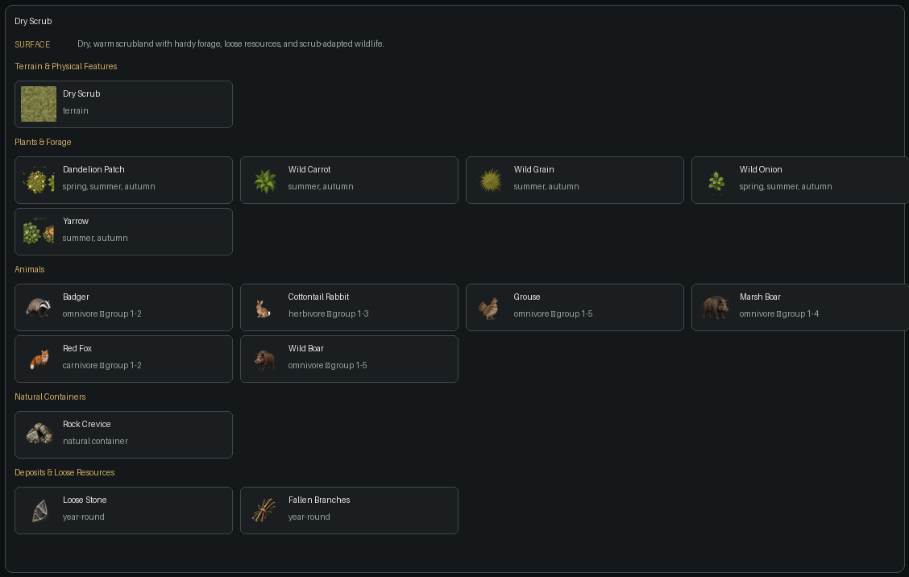

### Terrain and physical features

| Terrain | Runtime ID | Feature |
|---|---|---|
| Dry Scrub | core:scrub | terrain |

### Plants and forage

| Feature | Seasons | Density | Yields |
|---|---|---:|---|
| Amberroot Crown Patch | summer, autumn | 8 | Amberroot Crown x1 |
| Beech Nut Cup Patch | year-round | 30 | Beech Nut Cup x1 |
| Birch Catkin Cluster Patch | year-round | 60 | Birch Catkin Cluster x1 |
| Dandelion Patch | spring, summer, autumn | 110 | Dandelion x1-3 |
| Dogwood Stem Bundle Patch | year-round | 30 | Dogwood Stem Bundle x1 |
| Ghost Orchid Stem Patch | summer, autumn | 8 | Ghost Orchid Stem x1 |
| Hazel Catkin Spray Patch | year-round | 60 | Hazel Catkin Spray x1 |
| Juniper Bough Patch | year-round | 60 | Juniper Bough x1 |
| Oak Gall Cluster Patch | year-round | 60 | Oak Gall Cluster x1 |
| Resinous Pine Cone Patch | year-round | 60 | Resinous Pine Cone x1 |
| Silverleaf Sprig Patch | summer, autumn | 8 | Silverleaf Sprig x1 |
| Spruce Pitch Knot Patch | year-round | 60 | Spruce Pitch Knot x1 |
| Wild Carrot | summer, autumn | 55 | Wild Carrot x1-2 |
| Wild Grain | summer, autumn | 80 | Wild Grain x1-3 |
| Wild Onion | spring, summer, autumn | 65 | Wild Onion x1-3 |
| Willow Bark Curl Patch | year-round | 30 | Willow Bark Curl x1 |
| Yarrow | summer, autumn | 50 | Yarrow x1-3 |

### Animals

| Animal | Diet | Group | Climate-limited |
|---|---|---:|---|
| Badger | omnivore | 1-2 | yes |
| Cottontail Rabbit | herbivore | 1-3 | yes |
| Grouse | omnivore | 1-5 | yes |
| Marsh Boar | omnivore | 1-4 | yes |
| Red Fox | carnivore | 1-2 | yes |
| Wild Boar | omnivore | 1-5 | yes |

### Natural containers

| Feature | Seasons | Density | Yields |
|---|---|---:|---|
| Rock Crevice | year-round | 16 | — |

### Deposits and loose resources

| Feature | Seasons | Density | Yields |
|---|---|---:|---|
| Loose Stone | year-round | 160 | Stone x1-2 |
| Fallen Branches | year-round | 170 | Brush x1-2, Branch x1-2 |

## Tundra

Cold open ground. Current authored resource coverage is sparse and strongly climate-limited.

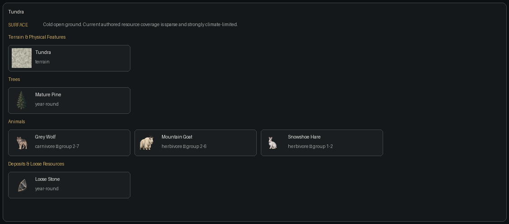

### Terrain and physical features

| Terrain | Runtime ID | Feature |
|---|---|---|
| Tundra | core:tundra | terrain |

### Trees

| Feature | Seasons | Density | Yields |
|---|---|---:|---|
| Mature Pine | year-round | 380 | Bark x1-2, Wood x3-6 |

### Plants and forage

| Feature | Seasons | Density | Yields |
|---|---|---:|---|
| Alpine Sorrel Root Patch | year-round | 30 | Alpine Sorrel Root x1 |
| Cotton Grass Tuft Patch | year-round | 30 | Cotton Grass Tuft x1 |
| Crimson Stonecrop Crown Patch | year-round | 8 | Crimson Stonecrop Crown x1 |
| Crowberry Stem Mat Patch | year-round | 60 | Crowberry Stem Mat x1 |
| Dwarf Willow Twigs Patch | year-round | 60 | Dwarf Willow Twigs x1 |
| Frost Sage Branch Patch | year-round | 8 | Frost Sage Branch x1 |
| Mountain Avens Seedhead Patch | year-round | 60 | Mountain Avens Seedhead x1 |
| Reindeer Lichen Mat Patch | year-round | 60 | Reindeer Lichen Mat x1 |

### Animals

| Animal | Diet | Group | Climate-limited |
|---|---|---:|---|
| Grey Wolf | carnivore | 2-7 | yes |
| Mountain Goat | herbivore | 2-6 | yes |
| Snowshoe Hare | herbivore | 1-2 | yes |

### Deposits and loose resources

| Feature | Seasons | Density | Yields |
|---|---|---:|---|
| Loose Stone | year-round | 160 | Stone x1-2 |

## Rocky Uplands

Exposed rocky ground associated with steep or high terrain.

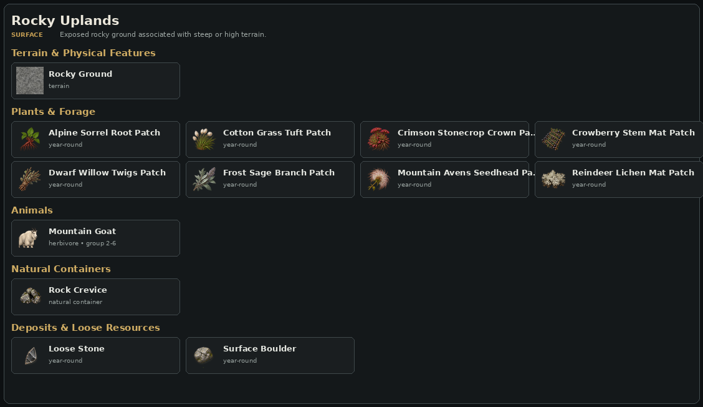

### Terrain and physical features

| Terrain | Runtime ID | Feature |
|---|---|---|
| Rocky Ground | core:rock | terrain |

### Plants and forage

| Feature | Seasons | Density | Yields |
|---|---|---:|---|
| Alpine Sorrel Root Patch | year-round | 30 | Alpine Sorrel Root x1 |
| Cotton Grass Tuft Patch | year-round | 30 | Cotton Grass Tuft x1 |
| Crimson Stonecrop Crown Patch | year-round | 8 | Crimson Stonecrop Crown x1 |
| Crowberry Stem Mat Patch | year-round | 60 | Crowberry Stem Mat x1 |
| Dwarf Willow Twigs Patch | year-round | 60 | Dwarf Willow Twigs x1 |
| Frost Sage Branch Patch | year-round | 8 | Frost Sage Branch x1 |
| Mountain Avens Seedhead Patch | year-round | 60 | Mountain Avens Seedhead x1 |
| Reindeer Lichen Mat Patch | year-round | 60 | Reindeer Lichen Mat x1 |

### Animals

| Animal | Diet | Group | Climate-limited |
|---|---|---:|---|
| Mountain Goat | herbivore | 2-6 | yes |

### Natural containers

| Feature | Seasons | Density | Yields |
|---|---|---:|---|
| Rock Crevice | year-round | 16 | — |

### Deposits and loose resources

| Feature | Seasons | Density | Yields |
|---|---|---:|---|
| Loose Stone | year-round | 160 | Stone x1-2 |
| Surface Boulder | year-round | 140 | Stone x2-5 |

## Wetland

Wet soil and standing-water margins supporting moisture-dependent plants and natural containers.

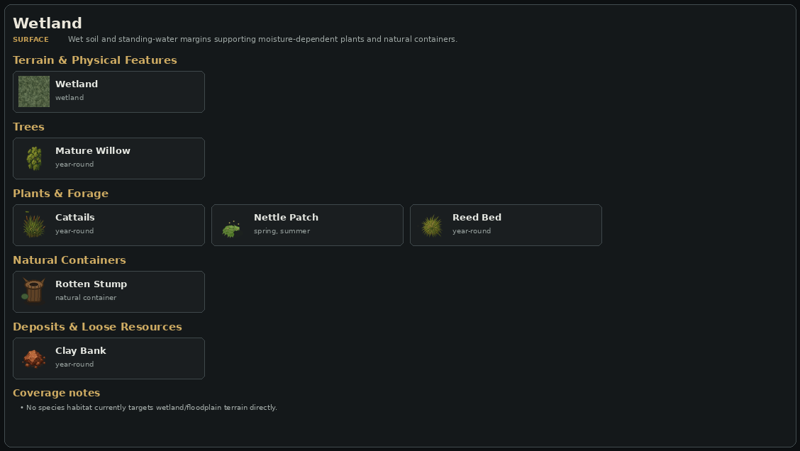

### Terrain and physical features

| Terrain | Runtime ID | Feature |
|---|---|---|
| Wetland | core:wetland | wetland |

### Trees

| Feature | Seasons | Density | Yields |
|---|---|---:|---|
| Mature Willow | year-round | 120 | Bark x2-4, Branch x1-2, Wood x2-4 |

### Plants and forage

| Feature | Seasons | Density | Yields |
|---|---|---:|---|
| Alder Cone Cluster Patch | year-round | 60 | Alder Cone Cluster x1 |
| Blue Lotus Stalk Patch | summer, autumn | 8 | Blue Lotus Stalk x1 |
| Bog Myrtle Branch Patch | year-round | 60 | Bog Myrtle Branch x1 |
| Cattail Seed Head Patch | year-round | 60 | Cattail Seed Head x1 |
| Cattails | year-round | 105 | Cattail Root x1-2, Reeds x1-2 |
| Duckweed Mat | spring, summer, autumn | 85 | Duckweed x1-4 |
| Marsh Amber Bulb Patch | summer, autumn | 8 | Marsh Amber Bulb x1 |
| Marsh Mallow Stems Patch | year-round | 60 | Marsh Mallow Stems x1 |
| Nettle Patch | spring, summer | 80 | Brush x1-2, Nettle x1-3 |
| Peat Moss Clump Patch | year-round | 30 | Peat Moss Clump x1 |
| Pickerelweed | spring, summer, autumn | 75 | Pickerelweed x1-3 |
| Reed Bed | year-round | 220 | Reeds x2-5 |
| Rush Pith Bundle Patch | year-round | 60 | Rush Pith Bundle x1 |
| Sedge Root Mat Patch | year-round | 60 | Sedge Root Mat x1 |
| Star Reed Tuft Patch | summer, autumn | 8 | Star Reed Tuft x1 |
| Sweet Flag Root Patch | year-round | 30 | Sweet Flag Root x1 |
| Water Iris Rhizome Patch | year-round | 30 | Water Iris Rhizome x1 |
| Water Lilies | spring, summer | 45 | Water Lily Root x1-2 |

### Animals

| Animal | Diet | Group | Climate-limited |
|---|---|---:|---|
| Beaver | herbivore | 1-3 | yes |
| Great Blue Heron | carnivore | 1-2 | yes |
| Muskrat | herbivore | 1-4 | yes |
| River Otter | carnivore | 1-3 | yes |

### Natural containers

| Feature | Seasons | Density | Yields |
|---|---|---:|---|
| Rotten Stump | year-round | 20 | — |

### Deposits and loose resources

| Feature | Seasons | Density | Yields |
|---|---|---:|---|
| Clay Bank | year-round | 60 | Clay x1-3 |
| Worm-Rich Soil | spring, summer, autumn | 45 | Earthworms x2-5 |

## Floodplain

Fertile river-adjacent ground with wetland plants, clay, and deadwood containers.

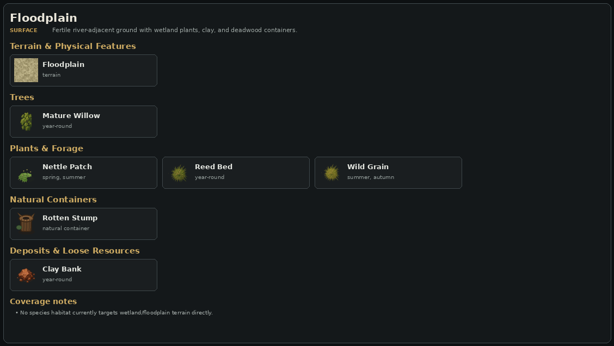

### Terrain and physical features

| Terrain | Runtime ID | Feature |
|---|---|---|
| Floodplain | core:floodplain | terrain |

### Trees

| Feature | Seasons | Density | Yields |
|---|---|---:|---|
| Mature Willow | year-round | 120 | Bark x2-4, Branch x1-2, Wood x2-4 |

### Plants and forage

| Feature | Seasons | Density | Yields |
|---|---|---:|---|
| Burdock Burr Cluster Patch | year-round | 60 | Burdock Burr Cluster x1 |
| Chicory Root Crown Patch | year-round | 60 | Chicory Root Crown x1 |
| Dried Teasel Head Patch | year-round | 60 | Dried Teasel Head x1 |
| Flax Seed Capsule Patch | year-round | 60 | Flax Seed Capsule x1 |
| Goldenrod Spray Patch | year-round | 30 | Goldenrod Spray x1 |
| Milkweed Pod Patch | year-round | 60 | Milkweed Pod x1 |
| Moonmint Sprig Patch | summer, autumn | 8 | Moonmint Sprig x1 |
| Mullein Flower Spike Patch | year-round | 60 | Mullein Flower Spike x1 |
| Nettle Patch | spring, summer | 80 | Brush x1-2, Nettle x1-3 |
| Pickerelweed | spring, summer, autumn | 75 | Pickerelweed x1-3 |
| Reed Bed | year-round | 220 | Reeds x2-5 |
| Rose Hip Branch Patch | year-round | 30 | Rose Hip Branch x1 |
| Saffron Crocus Tuft Patch | summer, autumn | 8 | Saffron Crocus Tuft x1 |
| Sunspice Rhizome Patch | summer, autumn | 8 | Sunspice Rhizome x1 |
| Sweet Clover Tops Patch | year-round | 30 | Sweet Clover Tops x1 |
| Wild Grain | summer, autumn | 80 | Wild Grain x1-3 |

### Animals

| Animal | Diet | Group | Climate-limited |
|---|---|---:|---|
| Beaver | herbivore | 1-3 | yes |
| Great Blue Heron | carnivore | 1-2 | yes |
| Muskrat | herbivore | 1-4 | yes |

### Natural containers

| Feature | Seasons | Density | Yields |
|---|---|---:|---|
| Rotten Stump | year-round | 20 | — |

### Deposits and loose resources

| Feature | Seasons | Density | Yields |
|---|---|---:|---|
| Clay Bank | year-round | 60 | Clay x1-3 |
| Worm-Rich Soil | spring, summer, autumn | 45 | Earthworms x2-5 |

## Sandy Ground

Dry or coastal-adjacent sand. Current natural-resource eligibility is limited.

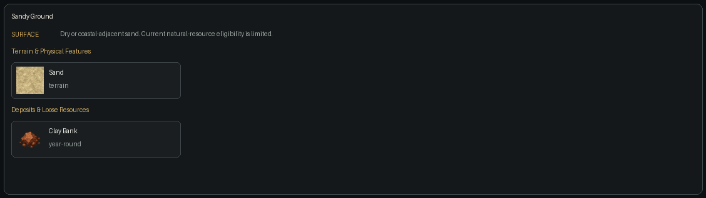

### Terrain and physical features

| Terrain | Runtime ID | Feature |
|---|---|---|
| Sand | core:sand | terrain |

### Deposits and loose resources

| Feature | Seasons | Density | Yields |
|---|---|---:|---|
| Clay Bank | year-round | 60 | Clay x1-3 |

## Rivers & Streams

River channels, rapids, streams, and banks generated by hydrology.

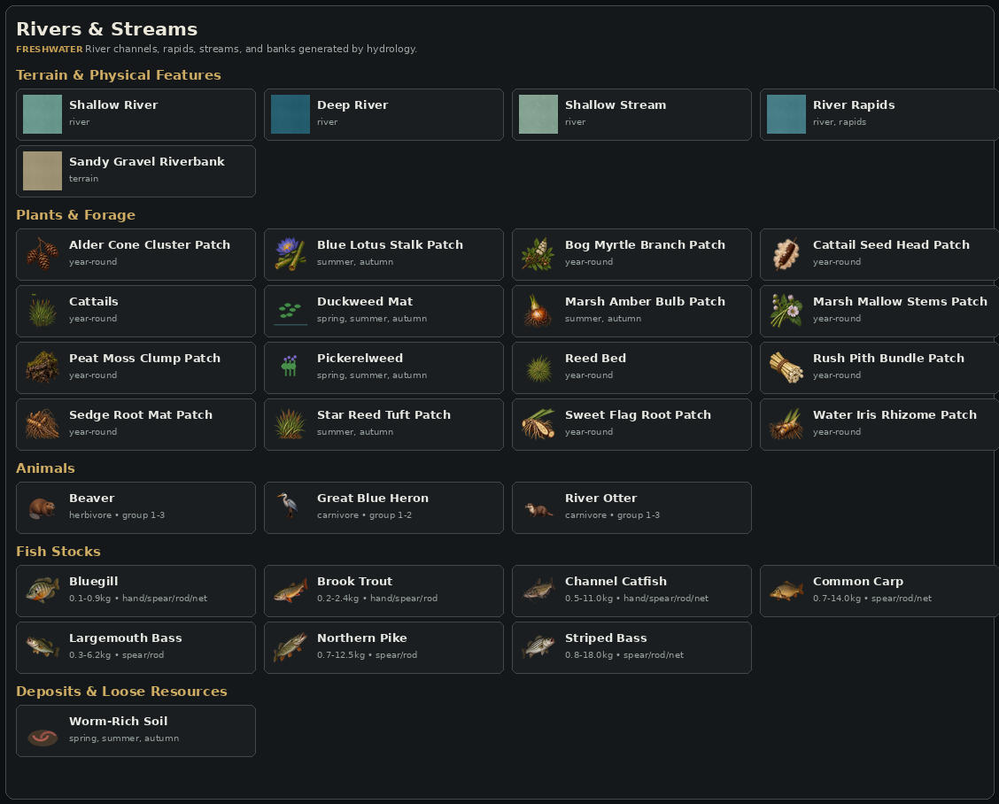

### Terrain and physical features

| Terrain | Runtime ID | Feature |
|---|---|---|
| Shallow River | core:river_shallow | river |
| Deep River | core:river | river |
| Shallow Stream | core:stream | river |
| River Rapids | core:river_rapids | river, rapids |
| Sandy Gravel Riverbank | core:riverbank | terrain |

### Plants and forage

| Feature | Seasons | Density | Yields |
|---|---|---:|---|
| Alder Cone Cluster Patch | year-round | 60 | Alder Cone Cluster x1 |
| Blue Lotus Stalk Patch | summer, autumn | 8 | Blue Lotus Stalk x1 |
| Bog Myrtle Branch Patch | year-round | 60 | Bog Myrtle Branch x1 |
| Cattail Seed Head Patch | year-round | 60 | Cattail Seed Head x1 |
| Cattails | year-round | 105 | Cattail Root x1-2, Reeds x1-2 |
| Duckweed Mat | spring, summer, autumn | 85 | Duckweed x1-4 |
| Marsh Amber Bulb Patch | summer, autumn | 8 | Marsh Amber Bulb x1 |
| Marsh Mallow Stems Patch | year-round | 60 | Marsh Mallow Stems x1 |
| Peat Moss Clump Patch | year-round | 30 | Peat Moss Clump x1 |
| Pickerelweed | spring, summer, autumn | 75 | Pickerelweed x1-3 |
| Reed Bed | year-round | 220 | Reeds x2-5 |
| Rush Pith Bundle Patch | year-round | 60 | Rush Pith Bundle x1 |
| Sedge Root Mat Patch | year-round | 60 | Sedge Root Mat x1 |
| Star Reed Tuft Patch | summer, autumn | 8 | Star Reed Tuft x1 |
| Sweet Flag Root Patch | year-round | 30 | Sweet Flag Root x1 |
| Water Iris Rhizome Patch | year-round | 30 | Water Iris Rhizome x1 |

### Animals

| Animal | Diet | Group | Climate-limited |
|---|---|---:|---|
| Beaver | herbivore | 1-3 | yes |
| Great Blue Heron | carnivore | 1-2 | yes |
| River Otter | carnivore | 1-3 | yes |

### Fish stocks

| Fish | Size range | Methods | Preferred bait |
|---|---:|---|---|
| Bluegill | 0.1-0.9 kg | hand/spear/rod/net | Earthworms, Berries |
| Brook Trout | 0.2-2.4 kg | hand/spear/rod | Copper Spoon Lure, Earthworms |
| Channel Catfish | 0.5-11.0 kg | hand/spear/rod/net | Offal, Earthworms |
| Common Carp | 0.7-14.0 kg | spear/rod/net | Berries, Earthworms |
| Largemouth Bass | 0.3-6.2 kg | spear/rod | Copper Spoon Lure, Earthworms |
| Northern Pike | 0.7-12.5 kg | spear/rod | Copper Spoon Lure, Offal |
| Striped Bass | 0.8-18.0 kg | spear/rod/net | Copper Spoon Lure, Offal, Earthworms |

### Deposits and loose resources

| Feature | Seasons | Density | Yields |
|---|---|---:|---|
| Worm-Rich Soil | spring, summer, autumn | 45 | Earthworms x2-5 |

## Freshwater Lakes

Shallow and deep freshwater basins plus the legacy generic deep-water terrain.

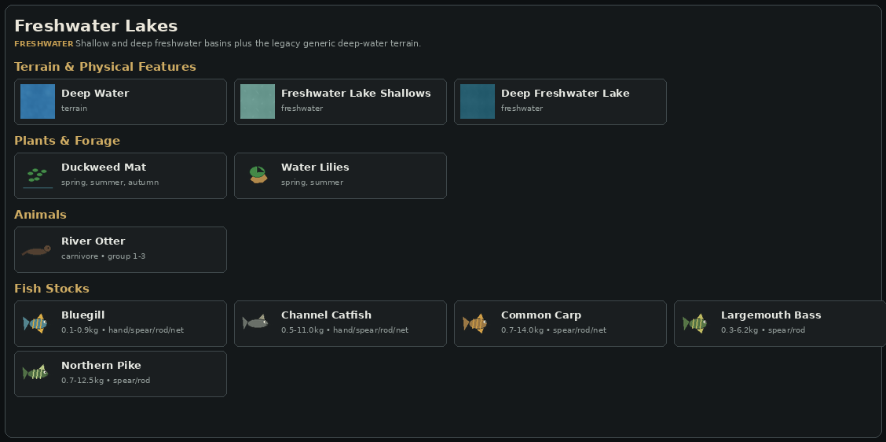

### Terrain and physical features

| Terrain | Runtime ID | Feature |
|---|---|---|
| Deep Water | core:water | terrain |
| Freshwater Lake Shallows | core:lake_shallow | freshwater |
| Deep Freshwater Lake | core:lake_deep | freshwater |

### Plants and forage

| Feature | Seasons | Density | Yields |
|---|---|---:|---|
| Duckweed Mat | spring, summer, autumn | 85 | Duckweed x1-4 |
| Water Lilies | spring, summer | 45 | Water Lily Root x1-2 |

### Animals

| Animal | Diet | Group | Climate-limited |
|---|---|---:|---|
| River Otter | carnivore | 1-3 | yes |

### Fish stocks

| Fish | Size range | Methods | Preferred bait |
|---|---:|---|---|
| Bluegill | 0.1-0.9 kg | hand/spear/rod/net | Earthworms, Berries |
| Channel Catfish | 0.5-11.0 kg | hand/spear/rod/net | Offal, Earthworms |
| Common Carp | 0.7-14.0 kg | spear/rod/net | Berries, Earthworms |
| Largemouth Bass | 0.3-6.2 kg | spear/rod | Copper Spoon Lure, Earthworms |
| Northern Pike | 0.7-12.5 kg | spear/rod | Copper Spoon Lure, Offal |

## Sandy Coast

Immediate sandy shoreline produced by coastal morphology.

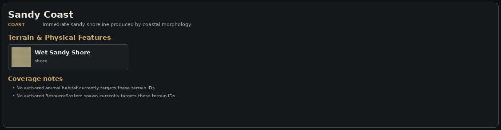

### Terrain and physical features

| Terrain | Runtime ID | Feature |
|---|---|---|
| Wet Sandy Shore | core:shore | shore |

### Plants and forage

| Feature | Seasons | Density | Yields |
|---|---|---:|---|
| Beachgrass ★ | year-round | 80 | Beachgrass x1-3 |

### Animals

| Animal | Diet | Group | Climate-limited |
|---|---|---:|---|
| Harbor Seal | carnivore | 1-5 | yes |
| Herring Gull | omnivore | 1-6 | yes |

## Rocky Coast

Rocky shores, gravel, and coastal cliffs selected from shoreline geology and morphology.

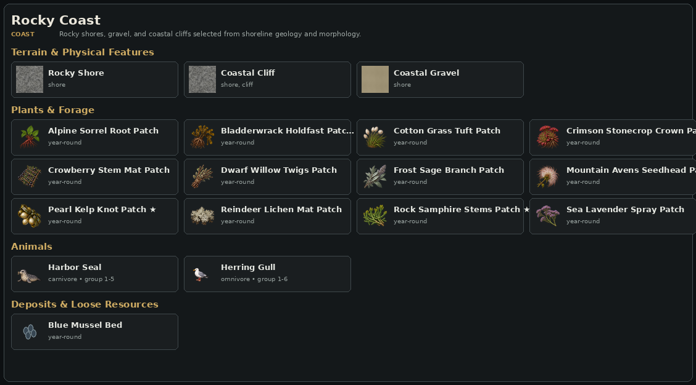

### Terrain and physical features

| Terrain | Runtime ID | Feature |
|---|---|---|
| Rocky Shore | core:rocky_shore | shore |
| Coastal Cliff | core:coastal_cliff | shore, cliff |
| Coastal Gravel | core:coastal_gravel | shore |

### Plants and forage

| Feature | Seasons | Density | Yields |
|---|---|---:|---|
| Alpine Sorrel Root Patch | year-round | 30 | Alpine Sorrel Root x1 |
| Bladderwrack Holdfast Patch ★ | year-round | 30 | Bladderwrack Holdfast x1 |
| Cotton Grass Tuft Patch | year-round | 30 | Cotton Grass Tuft x1 |
| Crimson Stonecrop Crown Patch | year-round | 8 | Crimson Stonecrop Crown x1 |
| Crowberry Stem Mat Patch | year-round | 60 | Crowberry Stem Mat x1 |
| Dwarf Willow Twigs Patch | year-round | 60 | Dwarf Willow Twigs x1 |
| Frost Sage Branch Patch | year-round | 8 | Frost Sage Branch x1 |
| Mountain Avens Seedhead Patch | year-round | 60 | Mountain Avens Seedhead x1 |
| Pearl Kelp Knot Patch ★ | year-round | 8 | Pearl Kelp Knot x1 |
| Reindeer Lichen Mat Patch | year-round | 60 | Reindeer Lichen Mat x1 |
| Rock Samphire Stems Patch ★ | year-round | 60 | Rock Samphire Stems x1 |
| Sea Lavender Spray Patch | year-round | 60 | Sea Lavender Spray x1 |

### Animals

| Animal | Diet | Group | Climate-limited |
|---|---|---:|---|
| Harbor Seal | carnivore | 1-5 | yes |
| Herring Gull | omnivore | 1-6 | yes |

### Deposits and loose resources

| Feature | Seasons | Density | Yields |
|---|---|---:|---|
| Blue Mussel Bed | year-round | 70 | Blue Mussels x1-4 |

## Tidal Wetlands

Tidal flats and salt marshes formed where coastal deposition and marsh potential are high.

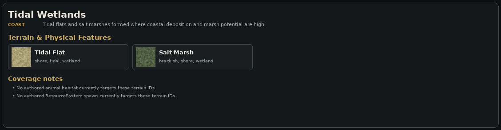

### Terrain and physical features

| Terrain | Runtime ID | Feature |
|---|---|---|
| Tidal Flat | core:tidal_flat | shore, tidal, wetland |
| Salt Marsh | core:salt_marsh | brackish, shore, wetland |

### Plants and forage

| Feature | Seasons | Density | Yields |
|---|---|---:|---|
| Alder Cone Cluster Patch | year-round | 60 | Alder Cone Cluster x1 |
| Bog Myrtle Branch Patch | year-round | 60 | Bog Myrtle Branch x1 |
| Cattail Seed Head Patch | year-round | 60 | Cattail Seed Head x1 |
| Marsh Amber Bulb Patch | summer, autumn | 8 | Marsh Amber Bulb x1 |
| Marsh Mallow Stems Patch | year-round | 60 | Marsh Mallow Stems x1 |
| Peat Moss Clump Patch | year-round | 30 | Peat Moss Clump x1 |
| Rush Pith Bundle Patch | year-round | 60 | Rush Pith Bundle x1 |
| Saltmarsh Grass ★ | year-round | 120 | Saltmarsh Grass x1-3 |
| Sea Lavender Spray Patch | year-round | 60 | Sea Lavender Spray x1 |
| Sedge Root Mat Patch | year-round | 60 | Sedge Root Mat x1 |
| Sweet Flag Root Patch | year-round | 30 | Sweet Flag Root x1 |

### Animals

| Animal | Diet | Group | Climate-limited |
|---|---|---:|---|
| Great Blue Heron | carnivore | 1-2 | yes |
| Herring Gull | omnivore | 1-6 | yes |
| Muskrat | herbivore | 1-4 | yes |

### Deposits and loose resources

| Feature | Seasons | Density | Yields |
|---|---|---:|---|
| Blue Mussel Bed | year-round | 70 | Blue Mussels x1-4 |

## Estuaries

Brackish shallow and deep channels where river and marine water meet.

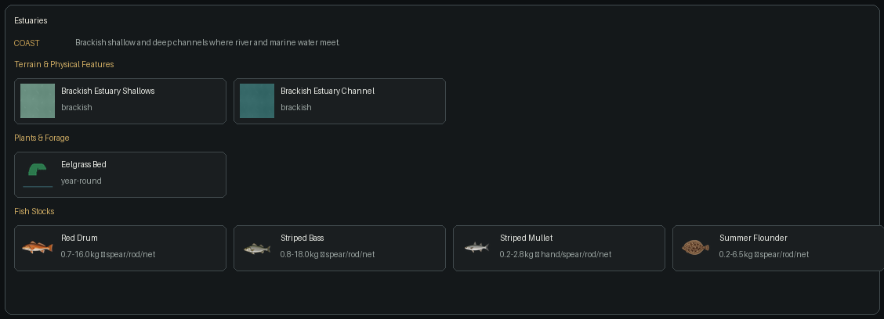

### Terrain and physical features

| Terrain | Runtime ID | Feature |
|---|---|---|
| Brackish Estuary Shallows | core:estuary_shallow | brackish |
| Brackish Estuary Channel | core:estuary_deep | brackish |

### Plants and forage

| Feature | Seasons | Density | Yields |
|---|---|---:|---|
| Eelgrass Bed | year-round | 100 | Eelgrass x1-3 |

### Fish stocks

| Fish | Size range | Methods | Preferred bait |
|---|---:|---|---|
| Red Drum | 0.7-16.0 kg | spear/rod/net | Copper Spoon Lure, Offal, Earthworms |
| Striped Bass | 0.8-18.0 kg | spear/rod/net | Copper Spoon Lure, Offal, Earthworms |
| Striped Mullet | 0.2-2.8 kg | hand/spear/rod/net | Earthworms, Berries |
| Summer Flounder | 0.2-6.5 kg | spear/rod/net | Offal, Earthworms |

## Ocean

Coastal wading water through shallow, shelf, and deep-ocean classes.

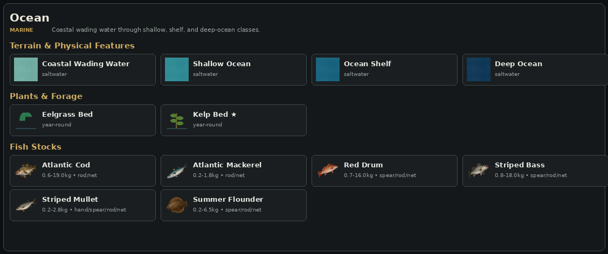

### Terrain and physical features

| Terrain | Runtime ID | Feature |
|---|---|---|
| Coastal Wading Water | core:ocean_wade | saltwater |
| Shallow Ocean | core:ocean_shallow | saltwater |
| Ocean Shelf | core:ocean_shelf | saltwater |
| Deep Ocean | core:ocean_deep | saltwater |

### Plants and forage

| Feature | Seasons | Density | Yields |
|---|---|---:|---|
| Eelgrass Bed | year-round | 100 | Eelgrass x1-3 |
| Kelp Bed ★ | year-round | 70 | Kelp x1-3 |

### Fish stocks

| Fish | Size range | Methods | Preferred bait |
|---|---:|---|---|
| Atlantic Cod | 0.6-19.0 kg | rod/net | Offal, Copper Spoon Lure |
| Atlantic Mackerel | 0.2-1.8 kg | rod/net | Copper Spoon Lure, Offal |
| Red Drum | 0.7-16.0 kg | spear/rod/net | Copper Spoon Lure, Offal, Earthworms |
| Striped Bass | 0.8-18.0 kg | spear/rod/net | Copper Spoon Lure, Offal, Earthworms |
| Striped Mullet | 0.2-2.8 kg | hand/spear/rod/net | Earthworms, Berries |
| Summer Flounder | 0.2-6.5 kg | spear/rod/net | Offal, Earthworms |

## Caves & Subterranean

Cave entrances, passages, shafts, aquifers, and mineral-bearing underground terrain.

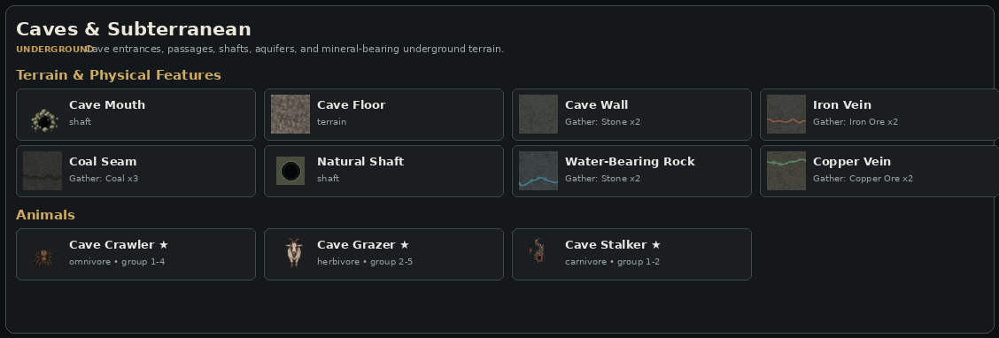

### Terrain and physical features

| Terrain | Runtime ID | Feature |
|---|---|---|
| Cave Mouth | core:cave_mouth | shaft |
| Cave Floor | core:cave_floor | terrain |
| Cave Wall | core:cave_wall | Gather: Stone x2 |
| Iron Vein | core:iron_vein | Gather: Iron Ore x2 |
| Coal Seam | core:coal_seam | Gather: Coal x3 |
| Natural Shaft | core:shaft | shaft |
| Water-Bearing Rock | core:aquifer | Gather: Stone x2 |
| Copper Vein | core:copper_vein | Gather: Copper Ore x2 |

### Animals

| Animal | Diet | Group | Climate-limited |
|---|---|---:|---|
| Cave Crawler ★ | omnivore | 1-4 | no |
| Cave Grazer ★ | herbivore | 2-5 | no |
| Cave Stalker ★ | carnivore | 1-2 | no |

## Ancient Ruins

Subterranean ancient masonry, walls, and relic-cache terrain.

### Terrain and physical features

| Terrain | Runtime ID | Feature |
|---|---|---|
| Ancient Masonry | core:ruin_floor | ruin |
| Ancient Wall | core:ruin_wall | Gather: Stone x3 |
| Relic Cache | core:relic_cache | Gather: Relic x1 |

### Coverage notes

- Ruin terrain features are generated as underground site terrain rather than ResourceSystem spawns.

## Managed Farmland

Player-managed tilled soil. Crops are planted rather than natural biome spawns.

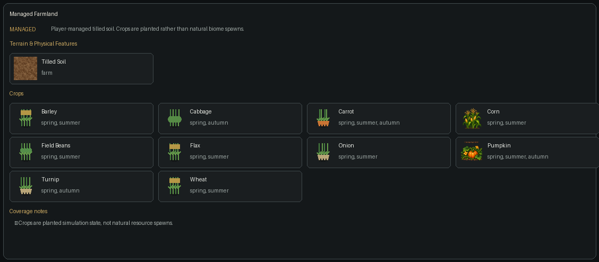

### Terrain and physical features

| Terrain | Runtime ID | Feature |
|---|---|---|
| Tilled Soil | core:tilled_soil | farm |

### Crops

| Crop | Seasons |
|---|---|
| Barley | spring, summer |
| Cabbage | spring, autumn |
| Carrot | spring, summer, autumn |
| Corn | spring, summer |
| Field Beans | spring, summer |
| Flax | spring, summer |
| Onion | spring, summer |
| Pumpkin | spring, summer, autumn |
| Turnip | spring, autumn |
| Wheat | spring, summer |

### Coverage notes

- Crops are planted simulation state, not natural resource spawns.

