# WORLDSEED Item Atlas

This is the human-readable item/asset catalog. Stable content IDs stay unchanged for save compatibility. Edit `name`, `asset`, `category`, and optional `subcategory` in `worldseed/data/items.json`, then run `python tools/build_sprite_atlases.py --items-only`.

Common resources intentionally stay broad. Plants are split into wild/farmed groups; herbs are split into cooking/medical/poisonous groups.

The runtime atlas is `assets/atlases/items.png`; `assets/item_catalog.png` is the larger labeled preview.

## Resources

| Icon | Item | Stable ID | Asset |
|---|---|---|---|
|  | Bark | `core:bark` | `bark.png` |
|  | Branch | `core:stout_branch` | `branch.png` |
|  | Brush | `core:brush` | `brush.png` |
|  | Clay | `core:clay_lump` | `clay.png` |
|  | Coal | `core:coal` | `coal.png` |
|  | Copper Ore | `core:copper_ore` | `copper_ore.png` |
|  | Fiber | `core:fiber` | `fiber.png` |
|  | Iron Ore | `core:iron_ore` | `iron_ore.png` |
|  | Pine Boughs | `core:pine_bough` | `pine_bough.png` |
|  | Reeds | `core:reed_bundle` | `reeds.png` |
|  | Stone | `core:stone` | `stone.png` |
|  | Wood | `core:wood` | `wood.png` |

## Wild Plants

| Icon | Item | Stable ID | Asset |
|---|---|---|---|
| 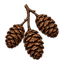 | Alder Cone Cluster | `core:alder_cone_cluster` | `salvage_alder_cone_cluster.png` |
|  | Alpine Sorrel Root | `core:alpine_sorrel_root` | `salvage_alpine_sorrel_root.png` |
|  | Amberroot Crown | `core:amberroot_crown` | `salvage_amberroot_crown.png` |
|  | Beachgrass | `core:beachgrass` | `beachgrass.png` |
|  | Beech Nut Cup | `core:beech_nut_cup` | `salvage_beech_nut_cup.png` |
|  | Berries | `core:berries` | `berries.png` |
| 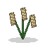 | Birch Catkin Cluster | `core:birch_catkin_cluster` | `salvage_birch_catkin_cluster.png` |
|  | Bladderwrack Holdfast | `core:bladderwrack_holdfast` | `salvage_bladderwrack_holdfast.png` |
|  | Blueberries | `core:blueberries` | `blueberries.png` |
| 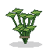 | Bog Myrtle Branch | `core:bog_myrtle_branch` | `salvage_bog_myrtle_branch.png` |
| 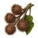 | Burdock Burr Cluster | `core:burdock_burr_cluster` | `salvage_burdock_burr_cluster.png` |
|  | Cattail Root | `core:cattail_root` | `cattail.png` |
| 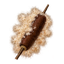 | Cattail Seed Head | `core:cattail_seed_head` | `salvage_cattail_seed_head.png` |
| 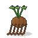 | Chicory Root Crown | `core:chicory_root_crown` | `salvage_chicory_root_crown.png` |
| 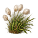 | Cotton Grass Tuft | `core:cotton_grass_tuft` | `salvage_cotton_grass_tuft.png` |
| 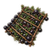 | Crowberry Stem Mat | `core:crowberry_stem_mat` | `salvage_crowberry_stem_mat.png` |
|  | Dogwood Stem Bundle | `core:dogwood_stem_bundle` | `salvage_dogwood_stem_bundle.png` |
|  | Dried Teasel Head | `core:dried_teasel_head` | `salvage_dried_teasel_head.png` |
|  | Duckweed | `core:duckweed` | `duckweed.png` |
|  | Dwarf Willow Twigs | `core:dwarf_willow_twigs` | `salvage_dwarf_willow_twigs.png` |
|  | Eelgrass | `core:eelgrass` | `eelgrass.png` |
| 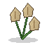 | Flax Seed Capsule | `core:flax_seed_capsule` | `salvage_flax_seed_capsule.png` |
| 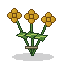 | Goldenrod Spray | `core:goldenrod_spray` | `salvage_goldenrod_spray.png` |
| 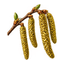 | Hazel Catkin Spray | `core:hazel_catkin_spray` | `salvage_hazel_catkin_spray.png` |
|  | Juniper Bough | `core:juniper_bough` | `salvage_juniper_bough.png` |
|  | Kelp | `core:kelp` | `kelp.png` |
| 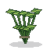 | Marsh Mallow Stems | `core:marsh_mallow_stems` | `salvage_marsh_mallow_stems.png` |
|  | Milkweed Pod | `core:milkweed_pod` | `salvage_milkweed_pod.png` |
|  | Mountain Avens Seedhead | `core:mountain_avens_seedhead` | `salvage_mountain_avens_seedhead.png` |
|  | Mullein Flower Spike | `core:mullein_flower_spike` | `salvage_mullein_flower_spike.png` |
|  | Nettle | `core:nettles` | `nettle.png` |
| 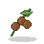 | Oak Gall Cluster | `core:oak_gall_cluster` | `salvage_oak_gall_cluster.png` |
|  | Pearl Kelp Knot | `core:pearl_kelp_knot` | `salvage_pearl_kelp_knot.png` |
| 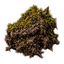 | Peat Moss Clump | `core:peat_moss_clump` | `salvage_peat_moss_clump.png` |
|  | Pickerelweed | `core:pickerelweed` | `pickerelweed.png` |
|  | Raspberries | `core:raspberries` | `raspberries.png` |
| 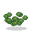 | Reindeer Lichen Mat | `core:reindeer_lichen_mat` | `salvage_reindeer_lichen_mat.png` |
| 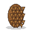 | Resinous Pine Cone | `core:resinous_pine_cone` | `salvage_resinous_pine_cone.png` |
|  | Rock Samphire Stems | `core:rock_samphire_stems` | `salvage_rock_samphire_stems.png` |
|  | Rose Hip Branch | `core:rose_hip_branch` | `salvage_rose_hip_branch.png` |
| 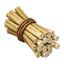 | Rush Pith Bundle | `core:rush_pith_bundle` | `salvage_rush_pith_bundle.png` |
|  | Saltmarsh Grass | `core:saltmarsh_grass` | `saltmarsh_grass.png` |
| 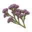 | Sea Lavender Spray | `core:sea_lavender_spray` | `salvage_sea_lavender_spray.png` |
| 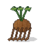 | Sedge Root Mat | `core:sedge_root_mat` | `salvage_sedge_root_mat.png` |
| 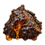 | Spruce Pitch Knot | `core:spruce_pitch_knot` | `salvage_spruce_pitch_knot.png` |
| 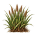 | Star Reed Tuft | `core:star_reed_tuft` | `salvage_star_reed_tuft.png` |
|  | Strawberries | `core:wild_strawberries` | `strawberries.png` |
| 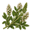 | Sweet Clover Tops | `core:sweet_clover_tops` | `salvage_sweet_clover_tops.png` |
| 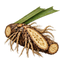 | Sweet Flag Root | `core:sweet_flag_root` | `salvage_sweet_flag_root.png` |
| 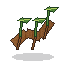 | Water Iris Rhizome | `core:water_iris_rhizome` | `salvage_water_iris_rhizome.png` |
|  | Water Lily Root | `core:water_lily_root` | `water_lily_root.png` |
|  | Wild Carrot | `core:wild_carrot` | `wild_carrot.png` |
|  | Wild Grain | `core:wild_grain` | `wild_grain.png` |
|  | Wild Onion | `core:wild_onion` | `wild_onion.png` |
| 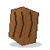 | Willow Bark Curl | `core:willow_bark_curl` | `salvage_willow_bark_curl.png` |

## Farmed Plants

| Icon | Item | Stable ID | Asset |
|---|---|---|---|
|  | Barley | `core:barley` | `barley.png` |
|  | Beans | `core:beans` | `beans.png` |
|  | Cabbage | `core:cabbage` | `cabbage.png` |
|  | Carrot | `core:carrot` | `carrot.png` |
| 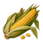 | Corn | `core:corn` | `corn.png` |
|  | Flax | `core:flax` | `flax.png` |
|  | Onion | `core:onion` | `onion.png` |
| 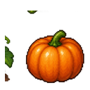 | Pumpkin | `core:pumpkin` | `pumpkin.png` |
|  | Turnip | `core:turnip` | `turnip.png` |
|  | Wheat | `core:wheat` | `wheat.png` |

## Cooking Herbs

| Icon | Item | Stable ID | Asset |
|---|---|---|---|
|  | Dandelion | `core:dandelion_greens` | `dandelion.png` |
| 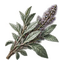 | Frost Sage Branch | `core:frost_sage_branch` | `salvage_frost_sage_branch.png` |
|  | Moonmint Sprig | `core:moonmint_sprig` | `salvage_moonmint_sprig.png` |
|  | Saffron Crocus Tuft | `core:saffron_crocus_tuft` | `salvage_saffron_crocus_tuft.png` |
|  | Sunspice Rhizome | `core:sunspice_rhizome` | `salvage_sunspice_rhizome.png` |

## Medical Herbs

| Icon | Item | Stable ID | Asset |
|---|---|---|---|
|  | Blue Lotus Stalk | `core:blue_lotus_stalk` | `salvage_blue_lotus_stalk.png` |
|  | Crimson Stonecrop Crown | `core:crimson_stonecrop_crown` | `salvage_crimson_stonecrop_crown.png` |
|  | Ghost Orchid Stem | `core:ghost_orchid_stem` | `salvage_ghost_orchid_stem.png` |
| 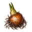 | Marsh Amber Bulb | `core:marsh_amber_bulb` | `salvage_marsh_amber_bulb.png` |
|  | Medical Herb | `core:medicinal_herb` | `medical_herb.png` |
|  | Plantain | `core:plantain_leaf` | `plantain.png` |
|  | Silverleaf Sprig | `core:silverleaf_sprig` | `salvage_silverleaf_sprig.png` |
|  | Yarrow | `core:yarrow` | `yarrow.png` |

## Food

| Icon | Item | Stable ID | Asset |
|---|---|---|---|
|  | Animal Fat | `core:animal_fat` | `animal_fat.png` |
|  | Atlantic Cod | `core:atlantic_cod` | `atlantic_cod.png` |
|  | Atlantic Mackerel | `core:atlantic_mackerel` | `atlantic_mackerel.png` |
| 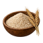 | Barley Meal | `core:barley_meal` | `craft_barley_meal.png` |
|  | Bean Crispbread | `core:bean_crispbread` | `craft_bean_crispbread.png` |
| 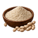 | Bean Flour | `core:bean_flour` | `craft_bean_flour.png` |
| 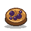 | Berry Barley Bun | `core:berry_barley_bun` | `berry_barley_bun.png` |
|  | Berry Reduction | `core:berry_reduction` | `craft_berry_reduction.png` |
|  | Blue Mussels | `core:blue_mussels` | `blue_mussels.png` |
|  | Bluegill | `core:bluegill` | `bluegill.png` |
|  | Bolete | `core:bolete` | `bolete.png` |
| 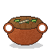 | Bone Stock | `core:bone_stock` | `craft_bone_stock.png` |
|  | Braised Meat | `core:braised_meat` | `craft_braised_meat.png` |
| 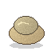 | Bread Dough | `core:bread_dough` | `craft_bread_dough.png` |
| 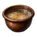 | Brewing Wort | `core:brewing_wort` | `craft_brewing_wort.png` |
|  | Brook Trout | `core:brook_trout` | `brook_trout.png` |
| 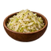 | Cabbage Ferment | `core:cabbage_ferment` | `craft_cabbage_ferment.png` |
|  | Cattail Starch | `core:cattail_starch` | `craft_cattail_starch.png` |
|  | Channel Catfish | `core:channel_catfish` | `channel_catfish.png` |
| 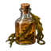 | Coastal Kelp Vinegar | `core:coastal_kelp_vinegar` | `craft_coastal_kelp_vinegar.png` |
|  | Common Carp | `core:common_carp` | `common_carp.png` |
|  | Cooked Meat | `core:cooked_meat` | `cooked_meat.png` |
| 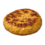 | Corn Griddle Cake | `core:corn_griddle_cake` | `craft_corn_griddle_cake.png` |
| 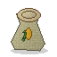 | Cornmeal | `core:cornmeal` | `craft_cornmeal.png` |
|  | Dried Meat | `core:dried_meat` | `dried_meat.png` |
| 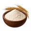 | Fine Sifted Flour | `core:fine_sifted_flour` | `craft_fine_sifted_flour.png` |
| 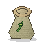 | Flax Meal | `core:flax_meal` | `craft_flax_meal.png` |
| 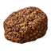 | Flax Travel Cake | `core:flax_travel_cake` | `craft_flax_travel_cake.png` |
|  | Flour | `core:flour` | `flour.png` |
|  | Frost Sage Brew | `core:frost_sage_brew` | `craft_frost_sage_brew.png` |
| 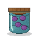 | Fruit Preserve | `core:fruit_preserve` | `craft_fruit_preserve.png` |
|  | Game Meat | `core:raw_game_meat` | `game_meat.png` |
| 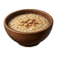 | Grain Porridge | `core:grain_porridge` | `craft_grain_porridge.png` |
| 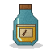 | Grain Table Beer | `core:grain_table_beer` | `craft_grain_table_beer.png` |
| 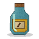 | Grain Vinegar | `core:grain_vinegar` | `craft_grain_vinegar.png` |
|  | Hearth Root Stew | `core:hearth_root_stew` | `hearth_root_stew.png` |
|  | Largemouth Bass | `core:largemouth_bass` | `largemouth_bass.png` |
| 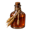 | Malt Tonic Drink | `core:malt_tonic_drink` | `craft_malt_tonic_drink.png` |
| 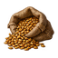 | Malted Grain | `core:malted_grain` | `craft_malted_grain.png` |
|  | Meat | `core:meat` | `meat.png` |
|  | Minced Game | `core:minced_game` | `craft_minced_game.png` |
|  | Moonmint Infusion | `core:moonmint_infusion` | `craft_moonmint_infusion.png` |
|  | Morel | `core:morel` | `morel.png` |
| 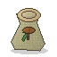 | Mushroom Powder | `core:mushroom_powder` | `craft_mushroom_powder.png` |
|  | Northern Pike | `core:northern_pike` | `northern_pike.png` |
|  | Offal | `core:offal` | `offal.png` |
| 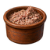 | Potted Meat | `core:potted_meat` | `craft_potted_meat.png` |
|  | Poultry | `core:raw_poultry` | `poultry.png` |
|  | Rack Dried Fish | `core:rack_dried_fish` | `craft_rack_dried_fish.png` |
|  | Red Drum | `core:red_drum` | `red_drum.png` |
|  | Rendered Tallow | `core:rendered_tallow` | `craft_rendered_tallow.png` |
|  | Roasted Grain Crumble | `core:roasted_grain_crumble` | `craft_roasted_grain_crumble.png` |
|  | Root Broth | `core:root_broth` | `craft_root_broth.png` |
|  | Root Dumplings | `core:root_dumplings` | `craft_root_dumplings.png` |
|  | Root Flour | `core:root_flour` | `craft_root_flour.png` |
|  | Rustic Bread | `core:bread` | `rustic_bread.png` |
|  | Savory Hand Pie | `core:savory_hand_pie` | `craft_savory_hand_pie.png` |
|  | Seared Game Portions | `core:seared_game_portions` | `craft_seared_game_portions.png` |
|  | Small Ale | `core:small_ale` | `small_ale.png` |
|  | Small Game Meat | `core:raw_small_game` | `small_game.png` |
|  | Smoked Fish | `core:smoked_fish` | `smoked_fish.png` |
|  | Smoked Offal Sausage | `core:smoked_offal_sausage` | `craft_smoked_offal_sausage.png` |
|  | Sourdough Loaf | `core:sourdough_loaf` | `craft_sourdough_loaf.png` |
|  | Sourdough Starter | `core:sourdough_starter` | `craft_sourdough_starter.png` |
|  | Soured Root Pickle | `core:soured_root_pickle` | `craft_soured_root_pickle.png` |
|  | Spiced Grain Cordial | `core:spiced_grain_cordial` | `craft_spiced_grain_cordial.png` |
|  | Split Fish Fillets | `core:split_fish_fillets` | `craft_split_fish_fillets.png` |
|  | Steam Raised Grain Bun | `core:steam_raised_grain_bun` | `craft_steam_raised_grain_bun.png` |
|  | Striped Bass | `core:striped_bass` | `striped_bass.png` |
|  | Striped Mullet | `core:striped_mullet` | `striped_mullet.png` |
|  | Summer Flounder | `core:summer_flounder` | `summer_flounder.png` |
|  | Thickened Mushroom Soup | `core:thickened_mushroom_soup` | `craft_thickened_mushroom_soup.png` |
|  | Trail Hardtack | `core:trail_hardtack` | `craft_trail_hardtack.png` |
|  | Travel Stew Concentrate | `core:travel_stew_concentrate` | `craft_travel_stew_concentrate.png` |
|  | Twice Baked Rusk | `core:twice_baked_rusk` | `craft_twice_baked_rusk.png` |
|  | Unleavened Flatbread | `core:unleavened_flatbread` | `craft_unleavened_flatbread.png` |
|  | Vinegar Preserved Fish | `core:vinegar_preserved_fish` | `craft_vinegar_preserved_fish.png` |
|  | Wholegrain Flour | `core:wholegrain_flour` | `craft_wholegrain_flour.png` |
|  | Wilted Greens | `core:wilted_greens` | `craft_wilted_greens.png` |

## Seeds & Farming

| Icon | Item | Stable ID | Asset |
|---|---|---|---|
|  | Barley Seed | `core:barley_seed` | `barley_seed.png` |
|  | Bean Seed | `core:beans_seed` | `bean_seed.png` |
|  | Cabbage Seed | `core:cabbage_seed` | `cabbage_seed.png` |
|  | Carrot Seed | `core:carrot_seed` | `carrot_seed.png` |
|  | Corn Seed | `core:corn_seed` | `corn_seed.png` |
|  | Flax Seed | `core:flax_seed` | `flax_seed.png` |
|  | Onion Seed | `core:onion_seed` | `onion_seed.png` |
|  | Pumpkin Seed | `core:pumpkin_seed` | `pumpkin_seed.png` |
|  | Turnip Seed | `core:turnip_seed` | `turnip_seed.png` |
|  | Wheat Seed | `core:wheat_seed` | `wheat_seed.png` |

## Materials

| Icon | Item | Stable ID | Asset |
|---|---|---|---|
|  | Abrasive Powder | `core:abrasive_powder` | `craft_abrasive_powder.png` |
|  | Aromatic Oil | `core:aromatic_oil` | `component_aromatic_oil.png` |
|  | Bark Felt | `core:bark_felt` | `craft_bark_felt.png` |
|  | Bentwood Frame | `core:bentwood_frame` | `craft_bentwood_frame.png` |
|  | Binding Cord | `core:binding_cord` | `craft_binding_cord.png` |
|  | Bitter Herbal Extract | `core:bitter_herbal_extract` | `craft_bitter_herbal_extract.png` |
|  | Bone | `core:bone` | `bone.png` |
|  | Bone Arrow Point | `core:bone_arrow_point` | `craft_bone_arrow_point.png` |
|  | Bone Chips | `core:bone_chips` | `component_bone_chips.png` |
|  | Bone Meal | `core:bone_meal` | `bone_meal.png` |
|  | Botanical Brewing Sachet | `core:botanical_brewing_sachet` | `craft_botanical_brewing_sachet.png` |
|  | Braided Wool Cord | `core:braided_wool_cord` | `craft_braided_wool_cord.png` |
|  | Canvas Panel | `core:canvas_panel` | `craft_canvas_panel.png` |
|  | Carbon Pigment | `core:carbon_pigment` | `craft_carbon_pigment.png` |
|  | Carved Bone Barb | `core:carved_bone_barb` | `craft_carved_bone_barb.png` |
|  | Ceramic Filter Media | `core:ceramic_filter_media` | `craft_ceramic_filter_media.png` |
|  | Ceramic Shards | `core:ceramic_shards` | `component_ceramic_shards.png` |
|  | Clean Dressing Pad | `core:clean_dressing_pad` | `craft_clean_dressing_pad.png` |
|  | Clear Crystal | `core:clear_crystal` | `component_clear_crystal.png` |
|  | Cloth Scraps | `core:cloth_scraps` | `component_cloth_scraps.png` |
|  | Compost Blend | `core:compost_blend` | `craft_compost_blend.png` |
|  | Copper Granules | `core:copper_granules` | `craft_copper_granules.png` |
|  | Copper Ingot | `core:copper_ingot` | `copper_ingot.png` |
|  | Copper Sheet | `core:copper_sheet` | `craft_copper_sheet.png` |
|  | Copper Spinner Blade | `core:copper_spinner_blade` | `craft_copper_spinner_blade.png` |
|  | Copper Wire | `core:copper_wire` | `component_copper_wire.png` |
|  | Cordage | `core:plant_cordage` | `cordage.png` |
|  | Cured Leather Panel | `core:cured_leather_panel` | `craft_cured_leather_panel.png` |
|  | Dressed Stone | `core:dressed_stone` | `dressed_stone.png` |
|  | Feather | `core:feather` | `feather.png` |
|  | Feather Fletching | `core:feather_fletching` | `craft_feather_fletching.png` |
|  | Felt Padding | `core:felt_padding` | `craft_felt_padding.png` |
|  | Filtered Herb Concentrate | `core:filtered_herb_concentrate` | `craft_filtered_herb_concentrate.png` |
|  | Filtered Malt Culture | `core:filtered_malt_culture` | `craft_filtered_malt_culture.png` |
|  | Fine Gear | `core:fine_gear` | `component_fine_gear.png` |
|  | Fitted Grip | `core:fitted_grip` | `craft_fitted_grip.png` |
|  | Fitted Splint Frame | `core:fitted_splint_frame` | `craft_fitted_splint_frame.png` |
|  | Fresh Hide | `core:fresh_hide` | `fresh_hide.png` |
|  | Fur Felt | `core:fur_felt` | `craft_fur_felt.png` |
|  | Fur Grip Pad | `core:fur_grip_pad` | `craft_fur_grip_pad.png` |
|  | Glass Shards | `core:glass_shards` | `component_glass_shards.png` |
|  | Glazed Lure Bead | `core:glazed_lure_bead` | `craft_glazed_lure_bead.png` |
|  | Grain Binder Paste | `core:grain_binder_paste` | `craft_grain_binder_paste.png` |
|  | Hardened Leather | `core:hardened_leather` | `craft_hardened_leather.png` |
|  | Hardwood Blank | `core:hardwood_blank` | `craft_hardwood_blank.png` |
|  | Hide | `core:hide` | `hide.png` |
|  | Hide Glue | `core:hide_glue` | `craft_hide_glue.png` |
|  | Hinge Pair | `core:hinge_pair` | `craft_hinge_pair.png` |
|  | Horn Button Set | `core:horn_button_set` | `craft_horn_button_set.png` |
|  | Horn Laminate | `core:horn_laminate` | `craft_horn_laminate.png` |
|  | Iron Bloom | `core:iron_bloom` | `iron_bloom.png` |
|  | Iron Tool Blank | `core:iron_tool_blank` | `craft_iron_tool_blank.png` |
|  | Kiln Grog | `core:kiln_grog` | `craft_kiln_grog.png` |
|  | Laminated Bow Limbs | `core:laminated_bow_limbs` | `craft_laminated_bow_limbs.png` |
|  | Leather | `core:leather` | `leather.png` |
|  | Leather Grip Wrap | `core:leather_grip_wrap` | `craft_leather_grip_wrap.png` |
|  | Leather Lace | `core:leather_lace` | `craft_leather_lace.png` |
|  | Leather Scraps | `core:leather_scraps` | `component_leather_scraps.png` |
|  | Linen Panel | `core:linen_panel` | `craft_linen_panel.png` |
|  | Marsh Resin Balm | `core:marsh_resin_balm` | `craft_marsh_resin_balm.png` |
|  | Metal Scraps | `core:metal_scraps` | `component_metal_scraps.png` |
|  | Mineral Grit | `core:mineral_grit` | `component_mineral_grit.png` |
|  | Mortar Mix | `core:mortar_mix` | `craft_mortar_mix.png` |
|  | Nuts and Bolts | `core:nuts_and_bolts` | `component_nuts_and_bolts.png` |
|  | Oiled Leather | `core:oiled_leather` | `craft_oiled_leather.png` |
|  | Orchid Lotus Essence | `core:orchid_lotus_essence` | `craft_orchid_lotus_essence.png` |
|  | Parchment | `core:parchment` | `parchment.png` |
|  | Pasture Fiber Bundle | `core:pasture_fiber_bundle` | `craft_pasture_fiber_bundle.png` |
|  | Pitch Binder | `core:pitch_binder` | `craft_pitch_binder.png` |
|  | Planed Board | `core:planed_board` | `craft_planed_board.png` |
|  | Plant Fiber Pulp | `core:plant_fiber_pulp` | `craft_plant_fiber_pulp.png` |
|  | Plant Scraps | `core:plant_scraps` | `component_plant_scraps.png` |
|  | Polished Crystal Lens | `core:polished_crystal_lens` | `craft_polished_crystal_lens.png` |
|  | Polishing Slurry | `core:polishing_slurry` | `craft_polishing_slurry.png` |
|  | Pressed Plant Binder | `core:pressed_plant_binder` | `craft_pressed_plant_binder.png` |
|  | Pressed Pulp Board | `core:pressed_pulp_board` | `craft_pressed_pulp_board.png` |
|  | Rawhide | `core:rawhide` | `rawhide.png` |
|  | Recycled Rag Paper | `core:recycled_rag_paper` | `craft_recycled_rag_paper.png` |
|  | Reinforced Cloth | `core:reinforced_cloth` | `craft_reinforced_cloth.png` |
|  | Resin Lumps | `core:resin_lumps` | `component_resin_lumps.png` |
|  | Rivet Set | `core:rivet_set` | `craft_rivet_set.png` |
|  | Scraped Hide | `core:scraped_hide` | `scraped_hide.png` |
|  | Sealed Paper Panel | `core:sealed_paper_panel` | `craft_sealed_paper_panel.png` |
|  | Segmented Armor Plates | `core:segmented_armor_plates` | `craft_segmented_armor_plates.png` |
|  | Shaft Bundle | `core:shaft_bundle` | `craft_shaft_bundle.png` |
|  | Silver Filament | `core:silver_filament` | `component_silver_filament.png` |
|  | Silverleaf Powder | `core:silverleaf_powder` | `craft_silverleaf_powder.png` |
|  | Sinew | `core:sinew` | `sinew.png` |
|  | Sinew Cord | `core:sinew_cord` | `sinew_cord.png` |
|  | Sorted Crystal Faces | `core:sorted_crystal_faces` | `craft_sorted_crystal_faces.png` |
|  | Spun Yarn | `core:spun_yarn` | `craft_spun_yarn.png` |
|  | Steel Billet | `core:steel_billet` | `steel_billet.png` |
|  | Stone Blade Blank | `core:stone_blade_blank` | `craft_stone_blade_blank.png` |
|  | Stonecrop Cleansing Paste | `core:stonecrop_cleansing_paste` | `craft_stonecrop_cleansing_paste.png` |
|  | Tallow Dressing | `core:tallow_dressing` | `craft_tallow_dressing.png` |
|  | Tempered Clay | `core:tempered_clay` | `craft_tempered_clay.png` |
|  | Tempered Spring | `core:tempered_spring` | `component_tempered_spring.png` |
|  | Timber Wedge | `core:timber_wedge` | `craft_timber_wedge.png` |
|  | Tool Handles | `core:tool_handles` | `component_tool_handles.png` |
|  | Tough Fiber | `core:tough_fiber` | `component_tough_fiber.png` |
|  | Washed Ore Fragments | `core:washed_ore_fragments` | `craft_washed_ore_fragments.png` |
|  | Waxed Thread | `core:waxed_thread` | `craft_waxed_thread.png` |
|  | Wood Pieces | `core:wood_pieces` | `component_wood_pieces.png` |
|  | Wooden Dowels | `core:wooden_dowels` | `craft_wooden_dowels.png` |
|  | Wool Roving | `core:wool_roving` | `craft_wool_roving.png` |
|  | Woven Cloth | `core:woven_cloth` | `woven_cloth.png` |

## Medicine

| Icon | Item | Stable ID | Asset |
|---|---|---|---|
|  | Bandage | `core:bandage` | `bandage.png` |
|  | Soap | `core:soap` | `soap.png` |
|  | Splint | `core:splint` | `splint.png` |
|  | Tonic | `core:herbal_tonic` | `tonic.png` |

## Tools

| Icon | Item | Stable ID | Asset |
|---|---|---|---|
|  | Antler Skinning Knife | `core:antler_skinning_knife` | `craft_antler_skinning_knife.png` |
|  | Articulated Bone Awl | `core:articulated_bone_awl` | `craft_articulated_bone_awl.png` |
|  | Barbed Fishing Trident | `core:barbed_fishing_trident` | `craft_barbed_fishing_trident.png` |
|  | Bone Awl | `core:bone_awl` | `bone_awl.png` |
|  | Bone Hand Shears | `core:bone_hand_shears` | `craft_bone_hand_shears.png` |
|  | Bone Hunting Knife | `core:bone_hunting_knife` | `craft_bone_hunting_knife.png` |
|  | Bone Marrow Scoop | `core:bone_marrow_scoop` | `craft_bone_marrow_scoop.png` |
|  | Bone Needle | `core:bone_needle` | `bone_needle.png` |
|  | Bookbinders Needle | `core:bookbinders_needle` | `craft_bookbinders_needle.png` |
|  | Braided Fishing Line | `core:braided_line` | `braided_line.png` |
|  | Bristle Brush | `core:bristle_brush` | `craft_bristle_brush.png` |
|  | Butcher Cleaver | `core:butcher_cleaver` | `craft_butcher_cleaver.png` |
|  | Carpenter Brace | `core:carpenter_brace` | `craft_carpenter_brace.png` |
|  | Ceramic Pestle | `core:ceramic_pestle` | `craft_ceramic_pestle.png` |
|  | Ceramic Thimble | `core:ceramic_thimble` | `craft_ceramic_thimble.png` |
|  | Claw Hammer | `core:claw_hammer` | `craft_claw_hammer.png` |
|  | Crafted Pick | `core:crafted_pick` | `crafted_pick.png` |
|  | Crude Knife | `core:crude_knife` | `crude_knife.png` |
|  | Crystal Burnisher | `core:crystal_burnisher` | `craft_crystal_burnisher.png` |
|  | Crystal Edge Scalpel | `core:crystal_edge_scalpel` | `craft_crystal_edge_scalpel.png` |
|  | Digging Stick | `core:digging_stick` | `digging_stick.png` |
|  | Felling Axe | `core:felling_axe` | `craft_felling_axe.png` |
|  | Fiber Fishing Line | `core:fiber_line` | `fiber_line.png` |
|  | Fishing Net | `core:fishing_net` | `fishing_net.png` |
|  | Fishing Spear | `core:fishing_spear` | `fishing_spear.png` |
|  | Flint Hide Scraper | `core:flint_hide_scraper` | `craft_flint_hide_scraper.png` |
|  | Garden Dibber | `core:garden_dibber` | `craft_garden_dibber.png` |
|  | Geologists Hammer | `core:geologists_hammer` | `craft_geologists_hammer.png` |
|  | Granite Pestle | `core:granite_pestle` | `craft_granite_pestle.png` |
|  | Grinding Slab | `core:grinding_slab` | `craft_grinding_slab.png` |
|  | Grooved Mill Pestle | `core:grooved_mill_pestle` | `craft_grooved_mill_pestle.png` |
|  | Hardened Ceramic Edge | `core:hardened_ceramic_edge` | `craft_hardened_ceramic_edge.png` |
|  | Hardened Ore Auger | `core:hardened_ore_auger` | `craft_hardened_ore_auger.png` |
|  | Harvest Sickle | `core:harvest_sickle` | `craft_harvest_sickle.png` |
|  | Heavy Quarry Pick | `core:heavy_quarry_pick` | `craft_heavy_quarry_pick.png` |
|  | Hide Fleshing Beam | `core:hide_fleshing_beam` | `craft_hide_fleshing_beam.png` |
|  | Horn Seam Needle | `core:horn_seam_needle` | `craft_horn_seam_needle.png` |
|  | Iron Adze | `core:iron_adze` | `craft_iron_adze.png` |
|  | Iron Chisel | `core:iron_chisel` | `craft_iron_chisel.png` |
|  | Iron Pick | `core:iron_pick` | `iron_pick.png` |
|  | Iron Splitting Wedges | `core:iron_splitting_wedges` | `craft_iron_splitting_wedges.png` |
|  | Jointed Fishing Rod | `core:jointed_fishing_rod` | `craft_jointed_fishing_rod.png` |
|  | Kiln Piercing Spike | `core:kiln_piercing_spike` | `craft_kiln_piercing_spike.png` |
|  | Knotted Cast Net | `core:knotted_cast_net` | `craft_knotted_cast_net.png` |
|  | Leatherworker Awl | `core:leatherworker_awl` | `craft_leatherworker_awl.png` |
|  | Lens Mounted Needle | `core:lens_mounted_needle` | `craft_lens_mounted_needle.png` |
|  | Levered Nutcracker | `core:levered_nutcracker` | `craft_levered_nutcracker.png` |
|  | Lockpick | `core:lockpick` | `lockpick.png` |
|  | Loggers Mattock | `core:loggers_mattock` | `craft_loggers_mattock.png` |
|  | Long Handled Field Hoe | `core:long_handled_field_hoe` | `craft_long_handled_field_hoe.png` |
|  | Mason Hand Hammer | `core:mason_hand_hammer` | `craft_mason_hand_hammer.png` |
|  | Metal Frame Saw | `core:metal_frame_saw` | `craft_metal_frame_saw.png` |
|  | Notched Stone Knife | `core:notched_stone_knife` | `craft_notched_stone_knife.png` |
|  | Ore Sifting Screen | `core:ore_sifting_screen` | `craft_ore_sifting_screen.png` |
|  | Quarry Sledge | `core:quarry_sledge` | `craft_quarry_sledge.png` |
|  | Reed Fishing Rod | `core:reed_rod` | `reed_rod.png` |
|  | Root Lifting Spade | `core:root_lifting_spade` | `craft_root_lifting_spade.png` |
|  | Salvage Driver | `core:salvage_driver` | `craft_salvage_driver.png` |
|  | Seed Cleaning Screen | `core:seed_cleaning_screen` | `craft_seed_cleaning_screen.png` |
|  | Sinew Fishing Line | `core:sinew_line` | `sinew_line.png` |
|  | Sinew Stripper | `core:sinew_stripper` | `craft_sinew_stripper.png` |
|  | Socketed Iron Hoe | `core:socketed_iron_hoe` | `craft_socketed_iron_hoe.png` |
|  | Soil Turning Fork | `core:soil_turning_fork` | `craft_soil_turning_fork.png` |
|  | Splitting Maul | `core:splitting_maul` | `craft_splitting_maul.png` |
|  | Spring Tension Fishing Rod | `core:spring_tension_fishing_rod` | `craft_spring_tension_fishing_rod.png` |
|  | Steel Pick | `core:steel_pick` | `steel_pick.png` |
|  | Stone Axe | `core:stone_axe` | `stone_axe.png` |
|  | Stone Flake | `core:stone_flake` | `stone_flake.png` |
|  | Stone Hammer | `core:stone_hammer` | `stone_hammer.png` |
|  | Stone Hoe | `core:crude_hoe` | `stone_hoe.png` |
|  | Stone Knife | `core:stone_knife` | `stone_knife.png` |
|  | Stone Pick | `core:stone_pick` | `stone_pick.png` |
|  | Tensioned Timber Saw | `core:tensioned_timber_saw` | `craft_tensioned_timber_saw.png` |
|  | Timber Hook | `core:timber_hook` | `craft_timber_hook.png` |
|  | Tracker Skinning Set | `core:tracker_skinning_set` | `craft_tracker_skinning_set.png` |
|  | Twisted Reed Line | `core:twisted_reed_line` | `craft_twisted_reed_line.png` |
|  | Waxed Casting Line | `core:waxed_casting_line` | `craft_waxed_casting_line.png` |
|  | Weighted River Net | `core:weighted_river_net` | `craft_weighted_river_net.png` |
|  | Winnowing Sickle | `core:winnowing_sickle` | `craft_winnowing_sickle.png` |
|  | Wood Boring Auger | `core:wood_boring_auger` | `craft_wood_boring_auger.png` |
|  | Wood Fishing Rod | `core:wood_rod` | `wood_rod.png` |
|  | Wood Plane | `core:wood_plane` | `craft_wood_plane.png` |
|  | Woodworking Mallet | `core:woodworking_mallet` | `craft_woodworking_mallet.png` |

## Weapons

| Icon | Item | Stable ID | Asset |
|---|---|---|---|
|  | Antler Throwing Dart | `core:antler_throwing_dart` | `craft_antler_throwing_dart.png` |
|  | Barbed Hunting Spear | `core:barbed_hunting_spear` | `craft_barbed_hunting_spear.png` |
|  | Basalt Head Mace | `core:basalt_head_mace` | `craft_basalt_head_mace.png` |
|  | Club | `core:club` | `club.png` |
|  | Crafted Sword | `core:crafted_sword` | `crafted_sword.png` |
|  | Fire-Hardened Javelin | `core:wooden_spear` | `spear.png` |
|  | Folding Pole Spear | `core:folding_pole_spear` | `craft_folding_pole_spear.png` |
|  | Horn Shod Staff | `core:horn_shod_staff` | `craft_horn_shod_staff.png` |
|  | Hunting Reflex Bow | `core:hunting_reflex_bow` | `craft_hunting_reflex_bow.png` |
|  | Iron Sword | `core:iron_sword` | `iron_sword.png` |
|  | Primitive Self Bow | `core:short_bow` | `short_bow.png` |
|  | Recurve Hunting Bow | `core:recurve_hunting_bow` | `craft_recurve_hunting_bow.png` |
|  | Sling | `core:sling` | `sling.png` |
|  | Steel Sword | `core:steel_sword` | `steel_sword.png` |
|  | Weighted Hide Sling | `core:weighted_hide_sling` | `craft_weighted_hide_sling.png` |

## Ammo

| Icon | Item | Stable ID | Asset |
|---|---|---|---|
|  | Sling Stone | `core:sling_stone` | `sling_stone.png` |
|  | Stone Arrow | `core:wood_arrow` | `arrow.png` |

## Armor

| Icon | Item | Stable ID | Asset |
|---|---|---|---|
|  | Bark Lined Forester Hood | `core:bark_lined_forester_hood` | `craft_bark_lined_forester_hood.png` |
|  | Crafted Helmet | `core:crafted_helmet` | `crafted_helmet.png` |
|  | Fur Lined Hood | `core:fur_lined_hood` | `craft_fur_lined_hood.png` |
|  | Hardened Leather Cuirass | `core:hardened_leather_cuirass` | `craft_hardened_leather_cuirass.png` |
|  | Hide Kite Shield | `core:hide_kite_shield` | `hide_kite_shield.png` |
|  | Horn Faced Buckler | `core:horn_faced_buckler` | `craft_horn_faced_buckler.png` |
|  | Iron Heater Shield | `core:iron_heater_shield` | `iron_heater_shield.png` |
|  | Iron Helmet | `core:iron_helmet` | `iron_helmet.png` |
|  | Iron Lamellar Vest | `core:iron_lamellar_vest` | `craft_iron_lamellar_vest.png` |
|  | Laminated Paper Shield | `core:laminated_paper_shield` | `craft_laminated_paper_shield.png` |
|  | Layered Hunter Bracers | `core:layered_hunter_bracers` | `craft_layered_hunter_bracers.png` |
|  | Layered Paper Cap | `core:layered_paper_cap` | `craft_layered_paper_cap.png` |
|  | Layered Paper Coat | `core:layered_paper_coat` | `craft_layered_paper_coat.png` |
|  | Layered Winter Trousers | `core:layered_winter_trousers` | `craft_layered_winter_trousers.png` |
|  | Leather Bracers | `core:leather_bracers` | `leather_bracers.png` |
|  | Leather Hood | `core:leather_hood` | `leather_hood.png` |
|  | Leather Leggings | `core:leather_leggings` | `leather_leggings.png` |
|  | Leather Vest | `core:leather_vest` | `leather_vest.png` |
|  | Padded Coif | `core:padded_coif` | `craft_padded_coif.png` |
|  | Padded Mining Cap | `core:padded_mining_cap` | `craft_padded_mining_cap.png` |
|  | Pasture Winter Coat | `core:pasture_winter_coat` | `craft_pasture_winter_coat.png` |
|  | Pitch Laminated Shield | `core:pitch_laminated_shield` | `craft_pitch_laminated_shield.png` |
|  | Plated Mining Gauntlets | `core:plated_mining_gauntlets` | `craft_plated_mining_gauntlets.png` |
|  | Quilted Jerkin | `core:quilted_jerkin` | `craft_quilted_jerkin.png` |
|  | Rawhide Buckler | `core:rawhide_buckler` | `buckler.png` |
|  | Reinforced Gaiters | `core:reinforced_gaiters` | `craft_reinforced_gaiters.png` |
|  | Ribbed Wood Shield | `core:ribbed_wood_shield` | `craft_ribbed_wood_shield.png` |
|  | Riveted Work Gloves | `core:riveted_work_gloves` | `craft_riveted_work_gloves.png` |
|  | Sailcloth Travel Coat | `core:sailcloth_travel_coat` | `craft_sailcloth_travel_coat.png` |
|  | Steel Helmet | `core:steel_helmet` | `steel_helmet.png` |
|  | Steel Tower Shield | `core:steel_tower_shield` | `steel_tower_shield.png` |
|  | Wicker Shield | `core:wicker_shield` | `wicker_shield.png` |
|  | Wooden Round Shield | `core:wood_round_shield` | `wood_round_shield.png` |
|  | Wool Lined Mitts | `core:wool_lined_mitts` | `craft_wool_lined_mitts.png` |

## Utility & Containers

| Icon | Item | Stable ID | Asset |
|---|---|---|---|
|  | Articulated Spinner Lure | `core:articulated_spinner_lure` | `craft_articulated_spinner_lure.png` |
|  | Basket | `core:wicker_basket` | `basket.png` |
|  | Bowl | `core:wooden_bowl` | `bowl.png` |
|  | Carved Bone Hook | `core:carved_bone_hook` | `craft_carved_bone_hook.png` |
|  | Ceramic Distillation Coil | `core:ceramic_distillation_coil` | `craft_ceramic_distillation_coil.png` |
|  | Ceramic Mould | `core:ceramic_mould` | `craft_ceramic_mould.png` |
|  | Clay Pot | `core:clay_pot` | `clay_pot.png` |
|  | Copper Spoon Lure | `core:spoon_lure` | `spoon_lure.png` |
|  | Earthworms | `core:earthworms` | `earthworms.png` |
|  | Float Rig | `core:float_rig` | `craft_float_rig.png` |
|  | Porous Filter Candle | `core:porous_filter_candle` | `craft_porous_filter_candle.png` |
|  | Stoneware Crucible | `core:stoneware_crucible` | `craft_stoneware_crucible.png` |
|  | Storage Box | `core:wood_storage_box` | `storage_box.png` |
|  | Water Flask | `core:clean_water` | `water_flask.png` |
|  | Waterskin | `core:waterskin` | `waterskin.png` |

## Damaged Hardware

| Icon | Item | Stable ID | Asset |
|---|---|---|---|
|  | Bent Door Hinge | `core:bent_door_hinge` | `salvage_bent_door_hinge.png` |
|  | Bent Fire Poker | `core:bent_fire_poker` | `salvage_bent_fire_poker.png` |
|  | Bent Wagon Bracket | `core:bent_wagon_bracket` | `salvage_bent_wagon_bracket.png` |
|  | Broken Buckle | `core:broken_buckle` | `salvage_broken_buckle.png` |
|  | Broken Chain Link | `core:broken_chain_link` | `salvage_broken_chain_link.png` |
|  | Cracked Pan Handle | `core:cracked_pan_handle` | `salvage_cracked_pan_handle.png` |
|  | Cracked Sickle Head | `core:cracked_sickle_head` | `salvage_cracked_sickle_head.png` |
|  | Dented Candle Snuffer | `core:dented_candle_snuffer` | `salvage_dented_candle_snuffer.png` |
|  | Discarded Harness Bell | `core:discarded_harness_bell` | `salvage_discarded_harness_bell.png` |
|  | Discarded Spur | `core:discarded_spur` | `salvage_discarded_spur.png` |
|  | Jammed Clockwork Catch | `core:jammed_clockwork_catch` | `salvage_jammed_clockwork_catch.png` |
|  | Loose Gate Latch | `core:loose_gate_latch` | `salvage_loose_gate_latch.png` |
|  | Rusted Padlock | `core:rusted_padlock` | `salvage_rusted_padlock.png` |
|  | Rusted Stove Grate | `core:rusted_stove_grate` | `salvage_rusted_stove_grate.png` |
|  | Seized Hand Drill | `core:seized_hand_drill` | `salvage_seized_hand_drill.png` |
|  | Snapped Shears | `core:snapped_shears` | `salvage_snapped_shears.png` |
|  | Split Iron Ring | `core:split_iron_ring` | `salvage_split_iron_ring.png` |
|  | Worn Horseshoe | `core:worn_horseshoe` | `salvage_worn_horseshoe.png` |

## Broken Woodwork

| Icon | Item | Stable ID | Asset |
|---|---|---|---|
|  | Broken Cart Axle | `core:broken_cart_axle` | `salvage_broken_cart_axle.png` |
|  | Broken Chair Rung | `core:broken_chair_rung` | `salvage_broken_chair_rung.png` |
|  | Broken Ladder Step | `core:broken_ladder_step` | `salvage_broken_ladder_step.png` |
|  | Broken Loom Shuttle | `core:broken_loom_shuttle` | `salvage_broken_loom_shuttle.png` |
|  | Chipped Wooden Ladle | `core:chipped_wooden_ladle` | `salvage_chipped_wooden_ladle.png` |
|  | Cracked Barrel Stave | `core:cracked_barrel_stave` | `salvage_cracked_barrel_stave.png` |
|  | Cracked Spinning Distaff | `core:cracked_spinning_distaff` | `salvage_cracked_spinning_distaff.png` |
|  | Discarded Paddle | `core:discarded_paddle` | `salvage_discarded_paddle.png` |
|  | Discarded Yoke | `core:discarded_yoke` | `salvage_discarded_yoke.png` |
|  | Loose Window Shutter | `core:loose_window_shutter` | `salvage_loose_window_shutter.png` |
|  | Snapped Broom Shaft | `core:snapped_broom_shaft` | `salvage_snapped_broom_shaft.png` |
|  | Splintered Rake | `core:splintered_rake` | `salvage_splintered_rake.png` |
|  | Split Crate Lid | `core:split_crate_lid` | `salvage_split_crate_lid.png` |
|  | Split Tool Rack | `core:split_tool_rack` | `salvage_split_tool_rack.png` |
|  | Split Wagon Spoke | `core:split_wagon_spoke` | `salvage_split_wagon_spoke.png` |
|  | Warped Cupboard Door | `core:warped_cupboard_door` | `salvage_warped_cupboard_door.png` |
|  | Worn Rolling Pin | `core:worn_rolling_pin` | `salvage_worn_rolling_pin.png` |
|  | Worn Tent Peg | `core:worn_tent_peg` | `salvage_worn_tent_peg.png` |

## Worn Textiles

| Icon | Item | Stable ID | Asset |
|---|---|---|---|
|  | Broken Felt Slipper | `core:broken_felt_slipper` | `salvage_broken_felt_slipper.png` |
|  | Discarded Bandolier Lining | `core:discarded_bandolier_lining` | `salvage_discarded_bandolier_lining.png` |
|  | Discarded Cap Lining | `core:discarded_cap_lining` | `salvage_discarded_cap_lining.png` |
|  | Frayed Bedroll | `core:frayed_bedroll` | `salvage_frayed_bedroll.png` |
|  | Frayed Fishing Smock | `core:frayed_fishing_smock` | `salvage_frayed_fishing_smock.png` |
|  | Old Saddle Blanket | `core:old_saddle_blanket` | `salvage_old_saddle_blanket.png` |
|  | Ragged Quilt | `core:ragged_quilt` | `salvage_ragged_quilt.png` |
|  | Split Grain Sack | `core:split_grain_sack` | `salvage_split_grain_sack.png` |
|  | Split Pillowcase | `core:split_pillowcase` | `salvage_split_pillowcase.png` |
|  | Stained Table Runner | `core:stained_table_runner` | `salvage_stained_table_runner.png` |
|  | Tangled Embroidery | `core:tangled_embroidery` | `salvage_tangled_embroidery.png` |
|  | Threadbare Curtain | `core:threadbare_curtain` | `salvage_threadbare_curtain.png` |
|  | Torn Apron | `core:torn_apron` | `salvage_torn_apron.png` |
|  | Torn Banner | `core:torn_banner` | `salvage_torn_banner.png` |
|  | Torn Mosquito Veil | `core:torn_mosquito_veil` | `salvage_torn_mosquito_veil.png` |
|  | Unraveled Scarf | `core:unraveled_scarf` | `salvage_unraveled_scarf.png` |
|  | Worn Laundry Strap | `core:worn_laundry_strap` | `salvage_worn_laundry_strap.png` |
|  | Worn Sail Patch | `core:worn_sail_patch` | `salvage_worn_sail_patch.png` |

## Worn Leatherwork

| Icon | Item | Stable ID | Asset |
|---|---|---|---|
|  | Broken Glove | `core:broken_glove` | `salvage_broken_glove.png` |
|  | Broken Satchel Flap | `core:broken_satchel_flap` | `salvage_broken_satchel_flap.png` |
|  | Broken Scabbard | `core:broken_scabbard` | `salvage_broken_scabbard.png` |
|  | Cracked Belt | `core:cracked_belt` | `salvage_cracked_belt.png` |
|  | Cracked Saddle Flap | `core:cracked_saddle_flap` | `salvage_cracked_saddle_flap.png` |
|  | Cracked Sling Strap | `core:cracked_sling_strap` | `salvage_cracked_sling_strap.png` |
|  | Discarded Bridle | `core:discarded_bridle` | `salvage_discarded_bridle.png` |
|  | Discarded Muzzle | `core:discarded_muzzle` | `salvage_discarded_muzzle.png` |
|  | Loose Shield Grip | `core:loose_shield_grip` | `salvage_loose_shield_grip.png` |
|  | Old Bellows Skin | `core:old_bellows_skin` | `salvage_old_bellows_skin.png` |
|  | Split Harness Strap | `core:split_harness_strap` | `salvage_split_harness_strap.png` |
|  | Split Quiver Seam | `core:split_quiver_seam` | `salvage_split_quiver_seam.png` |
|  | Split Water Bag | `core:split_water_bag` | `salvage_split_water_bag.png` |
|  | Torn Hunting Gaiter | `core:torn_hunting_gaiter` | `salvage_torn_hunting_gaiter.png` |
|  | Torn Leather Pouch | `core:torn_leather_pouch` | `salvage_torn_leather_pouch.png` |
|  | Worn Boot Sole | `core:worn_boot_sole` | `salvage_worn_boot_sole.png` |
|  | Worn Drum Head | `core:worn_drum_head` | `salvage_worn_drum_head.png` |
|  | Worn Knee Guard | `core:worn_knee_guard` | `salvage_worn_knee_guard.png` |

## Broken Ceramics

| Icon | Item | Stable ID | Asset |
|---|---|---|---|
|  | Broken Drain Pipe | `core:broken_drain_pipe` | `salvage_broken_drain_pipe.png` |
|  | Broken Flower Pot | `core:broken_flower_pot` | `salvage_broken_flower_pot.png` |
|  | Broken Kiln Spacer | `core:broken_kiln_spacer` | `salvage_broken_kiln_spacer.png` |
|  | Broken Oil Lamp | `core:broken_oil_lamp` | `salvage_broken_oil_lamp.png` |
|  | Broken Roof Tile | `core:broken_roof_tile` | `salvage_broken_roof_tile.png` |
|  | Chipped Chamber Pot | `core:chipped_chamber_pot` | `salvage_chipped_chamber_pot.png` |
|  | Chipped Crock | `core:chipped_crock` | `salvage_chipped_crock.png` |
|  | Chipped Mortar Bowl | `core:chipped_mortar_bowl` | `salvage_chipped_mortar_bowl.png` |
|  | Chipped Salt Cellar | `core:chipped_salt_cellar` | `salvage_chipped_salt_cellar.png` |
|  | Cracked Fermentation Weight | `core:cracked_fermentation_weight` | `salvage_cracked_fermentation_weight.png` |
|  | Cracked Honey Jar | `core:cracked_honey_jar` | `salvage_cracked_honey_jar.png` |
|  | Cracked Jug | `core:cracked_jug` | `salvage_cracked_jug.png` |
|  | Cracked Soap Dish | `core:cracked_soap_dish` | `salvage_cracked_soap_dish.png` |
|  | Discarded Crucible | `core:discarded_crucible` | `salvage_discarded_crucible.png` |
|  | Shattered Inkpot | `core:shattered_inkpot` | `salvage_shattered_inkpot.png` |
|  | Split Baking Stone | `core:split_baking_stone` | `salvage_split_baking_stone.png` |
|  | Split Butter Dish | `core:split_butter_dish` | `salvage_split_butter_dish.png` |
|  | Split Tea Bowl | `core:split_tea_bowl` | `salvage_split_tea_bowl.png` |

## Broken Glassware

| Icon | Item | Stable ID | Asset |
|---|---|---|---|
|  | Broken Glass Pendant | `core:broken_glass_pendant` | `salvage_broken_glass_pendant.png` |
|  | Broken Hourglass Bulb | `core:broken_hourglass_bulb` | `salvage_broken_hourglass_bulb.png` |
|  | Broken Lantern Globe | `core:broken_lantern_globe` | `salvage_broken_lantern_globe.png` |
|  | Broken Seal Stamp | `core:broken_seal_stamp` | `salvage_broken_seal_stamp.png` |
|  | Broken Spectacle Lens | `core:broken_spectacle_lens` | `salvage_broken_spectacle_lens.png` |
|  | Chipped Drinking Glass | `core:chipped_drinking_glass` | `salvage_chipped_drinking_glass.png` |
|  | Chipped Glass Bead | `core:chipped_glass_bead` | `salvage_chipped_glass_bead.png` |
|  | Chipped Glass Stopper | `core:chipped_glass_stopper` | `salvage_chipped_glass_stopper.png` |
|  | Clouded Prism | `core:clouded_prism` | `salvage_clouded_prism.png` |
|  | Clouded Window Pane | `core:clouded_window_pane` | `salvage_clouded_window_pane.png` |
|  | Cracked Apothecary Jar | `core:cracked_apothecary_jar` | `salvage_cracked_apothecary_jar.png` |
|  | Cracked Bottle Neck | `core:cracked_bottle_neck` | `salvage_cracked_bottle_neck.png` |
|  | Cracked Fishing Float | `core:cracked_fishing_float` | `salvage_cracked_fishing_float.png` |
|  | Cracked Mirror Edge | `core:cracked_mirror_edge` | `salvage_cracked_mirror_edge.png` |
|  | Shattered Measuring Tube | `core:shattered_measuring_tube` | `salvage_shattered_measuring_tube.png` |
|  | Shattered Perfume Vial | `core:shattered_perfume_vial` | `salvage_shattered_perfume_vial.png` |
|  | Split Glass Funnel | `core:split_glass_funnel` | `salvage_split_glass_funnel.png` |
|  | Split Lamp Chimney | `core:split_lamp_chimney` | `salvage_split_lamp_chimney.png` |

## Discarded Paperwork

| Icon | Item | Stable ID | Asset |
|---|---|---|---|
|  | Broken Seal Envelope | `core:broken_seal_envelope` | `salvage_broken_seal_envelope.png` |
|  | Broken Writing Board | `core:broken_writing_board` | `salvage_broken_writing_board.png` |
|  | Discarded Account Slip | `core:discarded_account_slip` | `salvage_discarded_account_slip.png` |
|  | Discarded Letter Bundle | `core:discarded_letter_bundle` | `salvage_discarded_letter_bundle.png` |
|  | Discarded Shipping Label | `core:discarded_shipping_label` | `salvage_discarded_shipping_label.png` |
|  | Faded Market Notice | `core:faded_market_notice` | `salvage_faded_market_notice.png` |
|  | Frayed Document Roll | `core:frayed_document_roll` | `salvage_frayed_document_roll.png` |
|  | Loose Book Binding | `core:loose_book_binding` | `salvage_loose_book_binding.png` |
|  | Molded Scroll Tube | `core:molded_scroll_tube` | `salvage_molded_scroll_tube.png` |
|  | Old Tax Register | `core:old_tax_register` | `salvage_old_tax_register.png` |
|  | Ruined Recipe Leaf | `core:ruined_recipe_leaf` | `salvage_ruined_recipe_leaf.png` |
|  | Split Notebook Cover | `core:split_notebook_cover` | `salvage_split_notebook_cover.png` |
|  | Split Wax Tablet | `core:split_wax_tablet` | `salvage_split_wax_tablet.png` |
|  | Tattered Charter Copy | `core:tattered_charter_copy` | `salvage_tattered_charter_copy.png` |
|  | Torn Map Case | `core:torn_map_case` | `salvage_torn_map_case.png` |
|  | Torn Song Folio | `core:torn_song_folio` | `salvage_torn_song_folio.png` |
|  | Waterlogged Ledger | `core:waterlogged_ledger` | `salvage_waterlogged_ledger.png` |
|  | Waterstained Almanac | `core:waterstained_almanac` | `salvage_waterstained_almanac.png` |

## Broken Stonework

| Icon | Item | Stable ID | Asset |
|---|---|---|---|
|  | Broken Grindstone Rim | `core:broken_grindstone_rim` | `salvage_broken_grindstone_rim.png` |
|  | Broken Mosaic Piece | `core:broken_mosaic_piece` | `salvage_broken_mosaic_piece.png` |
|  | Broken Soapstone Cup | `core:broken_soapstone_cup` | `salvage_broken_soapstone_cup.png` |
|  | Broken Stone Spindle | `core:broken_stone_spindle` | `salvage_broken_stone_spindle.png` |
|  | Chipped Mill Fragment | `core:chipped_mill_fragment` | `salvage_chipped_mill_fragment.png` |
|  | Chipped Plumb Bob | `core:chipped_plumb_bob` | `salvage_chipped_plumb_bob.png` |
|  | Chipped Sandstone Disc | `core:chipped_sandstone_disc` | `salvage_chipped_sandstone_disc.png` |
|  | Chipped Stone Pestle | `core:chipped_stone_pestle` | `salvage_chipped_stone_pestle.png` |
|  | Cracked Door Sill | `core:cracked_door_sill` | `salvage_cracked_door_sill.png` |
|  | Cracked Hearth Brick | `core:cracked_hearth_brick` | `salvage_cracked_hearth_brick.png` |
|  | Cracked Slate Shingle | `core:cracked_slate_shingle` | `salvage_cracked_slate_shingle.png` |
|  | Fractured Mortar Block | `core:fractured_mortar_block` | `salvage_fractured_mortar_block.png` |
|  | Loose Gravel Paver | `core:loose_gravel_paver` | `salvage_loose_gravel_paver.png` |
|  | Split Chalk Marker | `core:split_chalk_marker` | `salvage_split_chalk_marker.png` |
|  | Split Quarry Wedge | `core:split_quarry_wedge` | `salvage_split_quarry_wedge.png` |
|  | Split Stone Weight | `core:split_stone_weight` | `salvage_split_stone_weight.png` |
|  | Worn Grinding Pebble | `core:worn_grinding_pebble` | `salvage_worn_grinding_pebble.png` |
|  | Worn Whetstone | `core:worn_whetstone` | `salvage_worn_whetstone.png` |

## Damaged Mechanisms

| Icon | Item | Stable ID | Asset |
|---|---|---|---|
|  | Bent Loom Ratchet | `core:bent_loom_ratchet` | `salvage_bent_loom_ratchet.png` |
|  | Broken Bellows Valve | `core:broken_bellows_valve` | `salvage_broken_bellows_valve.png` |
|  | Broken Crossbow Trigger | `core:broken_crossbow_trigger` | `salvage_broken_crossbow_trigger.png` |
|  | Broken Hand Lantern | `core:broken_hand_lantern` | `salvage_broken_hand_lantern.png` |
|  | Broken Spinning Reel | `core:broken_spinning_reel` | `salvage_broken_spinning_reel.png` |
|  | Broken Wagon Brake | `core:broken_wagon_brake` | `salvage_broken_wagon_brake.png` |
|  | Broken Winding Key | `core:broken_winding_key` | `salvage_broken_winding_key.png` |
|  | Cracked Balance Scale | `core:cracked_balance_scale` | `salvage_cracked_balance_scale.png` |
|  | Cracked Orrery Arm | `core:cracked_orrery_arm` | `salvage_cracked_orrery_arm.png` |
|  | Damaged Grinding Crank | `core:damaged_grinding_crank` | `salvage_damaged_grinding_crank.png` |
|  | Damaged Sighting Tube | `core:damaged_sighting_tube` | `salvage_damaged_sighting_tube.png` |
|  | Damaged Spring Trap | `core:damaged_spring_trap` | `salvage_damaged_spring_trap.png` |
|  | Damaged Survey Compass | `core:damaged_survey_compass` | `salvage_damaged_survey_compass.png` |
|  | Jammed Door Closer | `core:jammed_door_closer` | `salvage_jammed_door_closer.png` |
|  | Jammed Ratchet Wheel | `core:jammed_ratchet_wheel` | `salvage_jammed_ratchet_wheel.png` |
|  | Seized Clock Pendulum | `core:seized_clock_pendulum` | `salvage_seized_clock_pendulum.png` |
|  | Seized Music Box | `core:seized_music_box` | `salvage_seized_music_box.png` |
|  | Split Pump Piston | `core:split_pump_piston` | `salvage_split_pump_piston.png` |

## Spent Provisions

| Icon | Item | Stable ID | Asset |
|---|---|---|---|
|  | Broken Beeswax Comb | `core:broken_beeswax_comb` | `salvage_broken_beeswax_comb.png` |
|  | Cracked Nut Shells | `core:cracked_nut_shells` | `salvage_cracked_nut_shells.png` |
|  | Crumbled Herb Wreath | `core:crumbled_herb_wreath` | `salvage_crumbled_herb_wreath.png` |
|  | Discarded Reed Mat Offcuts | `core:discarded_reed_mat_offcuts` | `salvage_discarded_reed_mat_offcuts.png` |
|  | Discarded Tea Stems | `core:discarded_tea_stems` | `salvage_discarded_tea_stems.png` |
|  | Dried Citrus Peel | `core:dried_citrus_peel` | `salvage_dried_citrus_peel.png` |
|  | Dried Gourd Rind | `core:dried_gourd_rind` | `salvage_dried_gourd_rind.png` |
|  | Dried Onion Skins | `core:dried_onion_skins` | `salvage_dried_onion_skins.png` |
|  | Empty Seed Husk Bundle | `core:empty_seed_husk_bundle` | `salvage_empty_seed_husk_bundle.png` |
|  | Mildewed Grain Chaff | `core:mildewed_grain_chaff` | `salvage_mildewed_grain_chaff.png` |
|  | Molded Hop Sack | `core:molded_hop_sack` | `salvage_molded_hop_sack.png` |
|  | Old Apple Pressings | `core:old_apple_pressings` | `salvage_old_apple_pressings.png` |
|  | Old Spice Sweepings | `core:old_spice_sweepings` | `salvage_old_spice_sweepings.png` |
|  | Spent Dye Leaves | `core:spent_dye_leaves` | `salvage_spent_dye_leaves.png` |
|  | Spent Malt Heap | `core:spent_malt_heap` | `salvage_spent_malt_heap.png` |
|  | Split Pine Pitch Pot | `core:split_pine_pitch_pot` | `salvage_split_pine_pitch_pot.png` |
|  | Spoiled Flax Bundle | `core:spoiled_flax_bundle` | `salvage_spoiled_flax_bundle.png` |
|  | Spoiled Herb Sachet | `core:spoiled_herb_sachet` | `salvage_spoiled_herb_sachet.png` |

## Animal Parts

| Icon | Item | Stable ID | Asset |
|---|---|---|---|
|  | Badger Guard Hairs | `core:badger_guard_hairs` | `salvage_badger_guard_hairs.png` |
|  | Bear Claw Sheath | `core:bear_claw_sheath` | `salvage_bear_claw_sheath.png` |
|  | Beaver Incisor Pair | `core:beaver_incisor_pair` | `salvage_beaver_incisor_pair.png` |
|  | Boar Bristle Patch | `core:boar_bristle_patch` | `salvage_boar_bristle_patch.png` |
|  | Chicken Quill Bundle | `core:chicken_quill_bundle` | `salvage_chicken_quill_bundle.png` |
|  | Cow Horn Ring | `core:cow_horn_ring` | `salvage_cow_horn_ring.png` |
|  | Crawler Carapace Plate | `core:crawler_carapace_plate` | `salvage_crawler_carapace_plate.png` |
|  | Deer Antler Tip | `core:deer_antler_tip` | `salvage_deer_antler_tip.png` |
|  | Elk Tooth Row | `core:elk_tooth_row` | `salvage_elk_tooth_row.png` |
|  | Fox Tail Tuft | `core:fox_tail_tuft` | `salvage_fox_tail_tuft.png` |
|  | Goat Horn Sheath | `core:goat_horn_sheath` | `salvage_goat_horn_sheath.png` |
|  | Grazer Horn Chip | `core:grazer_horn_chip` | `salvage_grazer_horn_chip.png` |
|  | Grouse Down Tuft | `core:grouse_down_tuft` | `salvage_grouse_down_tuft.png` |
|  | Gull Wing Down | `core:gull_wing_down` | `salvage_gull_wing_down.png` |
|  | Heron Pinion Quills | `core:heron_pinion_quills` | `salvage_heron_pinion_quills.png` |
|  | Moose Hoof Plate | `core:moose_hoof_plate` | `salvage_moose_hoof_plate.png` |
|  | Muskrat Fur Clump | `core:muskrat_fur_clump` | `salvage_muskrat_fur_clump.png` |
|  | Otter Whisker Bundle | `core:otter_whisker_bundle` | `salvage_otter_whisker_bundle.png` |
|  | Rabbit Foot Tuft | `core:rabbit_foot_tuft` | `salvage_rabbit_foot_tuft.png` |
|  | Seal Whisker Pad | `core:seal_whisker_pad` | `salvage_seal_whisker_pad.png` |
|  | Sheep Wool Locks | `core:sheep_wool_locks` | `salvage_sheep_wool_locks.png` |
|  | Stalker Tendon Knot | `core:stalker_tendon_knot` | `salvage_stalker_tendon_knot.png` |
|  | Turkey Quill Fan | `core:turkey_quill_fan` | `salvage_turkey_quill_fan.png` |
|  | Wolf Fang Pair | `core:wolf_fang_pair` | `salvage_wolf_fang_pair.png` |

## Special

| Icon | Item | Stable ID | Asset |
|---|---|---|---|
|  | Book | `core:book` | `book.png` |
|  | Copper Coin | `core:copper_coin` | `copper_coin.png` |
|  | Key | `core:ancient_key` | `key.png` |
|  | Relic | `core:relic` | `relic.png` |

