# WORLDSEED Item Atlas

This is the human-readable item/asset catalog. Stable content IDs stay unchanged for save compatibility. Edit `name`, `asset`, `category`, and optional `subcategory` in `worldseed/data/items.json`, then run `python tools/build_sprite_atlases.py --items-only`.

Common resources intentionally stay broad. Plants are split into wild/farmed groups; herbs are split into cooking/medical/poisonous groups.

The runtime atlas is `assets/atlases/items.png`; `assets/item_catalog.png` is the larger labeled preview.

## Resources

| Icon | Item | Stable ID | Asset |
|---|---|---|---|
| 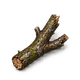 | Bark | `core:bark` | `bark.png` |
| 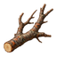 | Branch | `core:stout_branch` | `branch.png` |
| 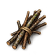 | Brush | `core:brush` | `brush.png` |
| 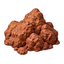 | Clay | `core:clay_lump` | `clay.png` |
| 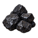 | Coal | `core:coal` | `coal.png` |
| 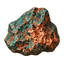 | Copper Ore | `core:copper_ore` | `copper_ore.png` |
| 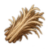 | Fiber | `core:fiber` | `fiber.png` |
| 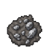 | Iron Ore | `core:iron_ore` | `iron_ore.png` |
| 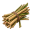 | Reeds | `core:reed_bundle` | `reeds.png` |
| 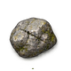 | Stone | `core:stone` | `stone.png` |
| 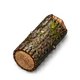 | Wood | `core:wood` | `wood.png` |

## Wild Plants

| Icon | Item | Stable ID | Asset |
|---|---|---|---|
| 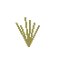 | Beachgrass | `core:beachgrass` | `beachgrass.png` |
| 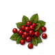 | Berries | `core:berries` | `berries.png` |
| 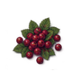 | Blueberries | `core:blueberries` | `blueberries.png` |
|  | Cattail Root | `core:cattail_root` | `cattail.png` |
| 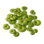 | Duckweed | `core:duckweed` | `duckweed.png` |
| 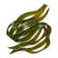 | Eelgrass | `core:eelgrass` | `eelgrass.png` |
| 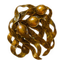 | Kelp | `core:kelp` | `kelp.png` |
| 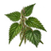 | Nettle | `core:nettles` | `nettle.png` |
| 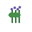 | Pickerelweed | `core:pickerelweed` | `pickerelweed.png` |
| 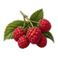 | Raspberries | `core:raspberries` | `raspberries.png` |
| 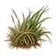 | Saltmarsh Grass | `core:saltmarsh_grass` | `saltmarsh_grass.png` |
| 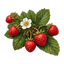 | Strawberries | `core:wild_strawberries` | `strawberries.png` |
|  | Water Lily Root | `core:water_lily_root` | `water_lily_root.png` |
| 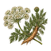 | Wild Carrot | `core:wild_carrot` | `wild_carrot.png` |
| 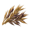 | Wild Grain | `core:wild_grain` | `wild_grain.png` |
| 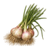 | Wild Onion | `core:wild_onion` | `wild_onion.png` |

## Farmed Plants

| Icon | Item | Stable ID | Asset |
|---|---|---|---|
| 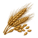 | Barley | `core:barley` | `barley.png` |
| 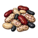 | Beans | `core:beans` | `beans.png` |
|  | Cabbage | `core:cabbage` | `cabbage.png` |
| 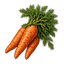 | Carrot | `core:carrot` | `carrot.png` |
| 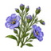 | Flax | `core:flax` | `flax.png` |
| 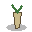 | Onion | `core:onion` | `onion.png` |
|  | Turnip | `core:turnip` | `turnip.png` |
| 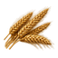 | Wheat | `core:wheat` | `wheat.png` |

## Cooking Herbs

| Icon | Item | Stable ID | Asset |
|---|---|---|---|
| 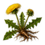 | Dandelion | `core:dandelion_greens` | `dandelion.png` |

## Medical Herbs

| Icon | Item | Stable ID | Asset |
|---|---|---|---|
| 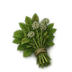 | Medical Herb | `core:medicinal_herb` | `medical_herb.png` |
| 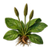 | Plantain | `core:plantain_leaf` | `plantain.png` |
| 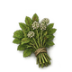 | Yarrow | `core:yarrow` | `yarrow.png` |

## Food

| Icon | Item | Stable ID | Asset |
|---|---|---|---|
| 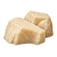 | Animal Fat | `core:animal_fat` | `animal_fat.png` |
| 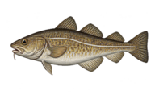 | Atlantic Cod | `core:atlantic_cod` | `atlantic_cod.png` |
| 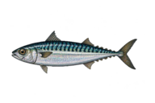 | Atlantic Mackerel | `core:atlantic_mackerel` | `atlantic_mackerel.png` |
| 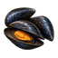 | Blue Mussels | `core:blue_mussels` | `blue_mussels.png` |
| 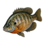 | Bluegill | `core:bluegill` | `bluegill.png` |
| 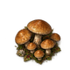 | Bolete | `core:bolete` | `bolete.png` |
| 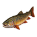 | Brook Trout | `core:brook_trout` | `brook_trout.png` |
| 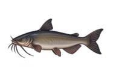 | Channel Catfish | `core:channel_catfish` | `channel_catfish.png` |
| 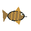 | Common Carp | `core:common_carp` | `common_carp.png` |
| 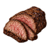 | Cooked Meat | `core:cooked_meat` | `cooked_meat.png` |
| 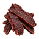 | Dried Meat | `core:dried_meat` | `dried_meat.png` |
| 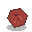 | Game Meat | `core:raw_game_meat` | `game_meat.png` |
| 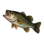 | Largemouth Bass | `core:largemouth_bass` | `largemouth_bass.png` |
|  | Meat | `core:meat` | `meat.png` |
| 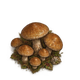 | Morel | `core:morel` | `morel.png` |
| 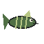 | Northern Pike | `core:northern_pike` | `northern_pike.png` |
|  | Offal | `core:offal` | `offal.png` |
|  | Poultry | `core:raw_poultry` | `poultry.png` |
|  | Red Drum | `core:red_drum` | `red_drum.png` |
|  | Small Game Meat | `core:raw_small_game` | `small_game.png` |
|  | Striped Bass | `core:striped_bass` | `striped_bass.png` |
|  | Striped Mullet | `core:striped_mullet` | `striped_mullet.png` |
|  | Summer Flounder | `core:summer_flounder` | `summer_flounder.png` |

## Seeds & Farming

| Icon | Item | Stable ID | Asset |
|---|---|---|---|
|  | Barley Seed | `core:barley_seed` | `barley_seed.png` |
|  | Bean Seed | `core:beans_seed` | `bean_seed.png` |
|  | Cabbage Seed | `core:cabbage_seed` | `cabbage_seed.png` |
|  | Carrot Seed | `core:carrot_seed` | `carrot_seed.png` |
|  | Flax Seed | `core:flax_seed` | `flax_seed.png` |
|  | Onion Seed | `core:onion_seed` | `onion_seed.png` |
|  | Turnip Seed | `core:turnip_seed` | `turnip_seed.png` |
|  | Wheat Seed | `core:wheat_seed` | `wheat_seed.png` |

## Materials

| Icon | Item | Stable ID | Asset |
|---|---|---|---|
|  | Bone | `core:bone` | `bone.png` |
|  | Bone Meal | `core:bone_meal` | `bone_meal.png` |
|  | Braided Fishing Line | `core:braided_line` | `braided_line.png` |
|  | Copper Ingot | `core:copper_ingot` | `copper_ingot.png` |
|  | Cordage | `core:plant_cordage` | `cordage.png` |
|  | Feather | `core:feather` | `feather.png` |
|  | Fiber Fishing Line | `core:fiber_line` | `fiber_line.png` |
|  | Fresh Hide | `core:fresh_hide` | `fresh_hide.png` |
|  | Hide | `core:hide` | `hide.png` |
|  | Iron Bloom | `core:iron_bloom` | `iron_bloom.png` |
|  | Leather | `core:leather` | `leather.png` |
|  | Parchment | `core:parchment` | `parchment.png` |
|  | Rawhide | `core:rawhide` | `rawhide.png` |
|  | Scraped Hide | `core:scraped_hide` | `scraped_hide.png` |
|  | Sinew | `core:sinew` | `sinew.png` |
|  | Sinew Cord | `core:sinew_cord` | `sinew_cord.png` |
|  | Sinew Fishing Line | `core:sinew_line` | `sinew_line.png` |
|  | Steel Billet | `core:steel_billet` | `steel_billet.png` |

## Medicine

| Icon | Item | Stable ID | Asset |
|---|---|---|---|
|  | Bandage | `core:bandage` | `bandage.png` |
|  | Soap | `core:soap` | `soap.png` |
|  | Splint | `core:splint` | `splint.png` |
|  | Tonic | `core:herbal_tonic` | `tonic.png` |

## Tools

| Icon | Item | Stable ID | Asset |
|---|---|---|---|
|  | Bone Awl | `core:bone_awl` | `bone_awl.png` |
|  | Bone Needle | `core:bone_needle` | `bone_needle.png` |
|  | Crafted Pick | `core:crafted_pick` | `crafted_pick.png` |
|  | Crude Knife | `core:crude_knife` | `crude_knife.png` |
|  | Digging Stick | `core:digging_stick` | `digging_stick.png` |
|  | Fishing Net | `core:fishing_net` | `fishing_net.png` |
|  | Fishing Spear | `core:fishing_spear` | `fishing_spear.png` |
|  | Iron Pick | `core:iron_pick` | `iron_pick.png` |
|  | Lockpick | `core:lockpick` | `lockpick.png` |
|  | Reed Fishing Rod | `core:reed_rod` | `reed_rod.png` |
|  | Steel Pick | `core:steel_pick` | `steel_pick.png` |
|  | Stone Axe | `core:stone_axe` | `stone_axe.png` |
|  | Stone Flake | `core:stone_flake` | `stone_flake.png` |
|  | Stone Hammer | `core:stone_hammer` | `stone_hammer.png` |
|  | Stone Hoe | `core:crude_hoe` | `stone_hoe.png` |
|  | Stone Knife | `core:stone_knife` | `stone_knife.png` |
|  | Stone Pick | `core:stone_pick` | `stone_pick.png` |
|  | Wood Fishing Rod | `core:wood_rod` | `wood_rod.png` |

## Weapons

| Icon | Item | Stable ID | Asset |
|---|---|---|---|
|  | Club | `core:club` | `club.png` |
|  | Crafted Sword | `core:crafted_sword` | `crafted_sword.png` |
|  | Fire-Hardened Javelin | `core:wooden_spear` | `spear.png` |
|  | Iron Sword | `core:iron_sword` | `iron_sword.png` |
|  | Primitive Self Bow | `core:short_bow` | `short_bow.png` |
|  | Sling | `core:sling` | `sling.png` |
|  | Steel Sword | `core:steel_sword` | `steel_sword.png` |

## Ammo

| Icon | Item | Stable ID | Asset |
|---|---|---|---|
|  | Sling Stone | `core:sling_stone` | `sling_stone.png` |
|  | Stone Arrow | `core:wood_arrow` | `arrow.png` |

## Armor

| Icon | Item | Stable ID | Asset |
|---|---|---|---|
|  | Crafted Helmet | `core:crafted_helmet` | `crafted_helmet.png` |
|  | Hide Kite Shield | `core:hide_kite_shield` | `hide_kite_shield.png` |
|  | Iron Heater Shield | `core:iron_heater_shield` | `iron_heater_shield.png` |
|  | Iron Helmet | `core:iron_helmet` | `iron_helmet.png` |
|  | Leather Bracers | `core:leather_bracers` | `leather_bracers.png` |
|  | Leather Hood | `core:leather_hood` | `leather_hood.png` |
|  | Leather Leggings | `core:leather_leggings` | `leather_leggings.png` |
|  | Leather Vest | `core:leather_vest` | `leather_vest.png` |
|  | Rawhide Buckler | `core:rawhide_buckler` | `buckler.png` |
|  | Steel Helmet | `core:steel_helmet` | `steel_helmet.png` |
|  | Steel Tower Shield | `core:steel_tower_shield` | `steel_tower_shield.png` |
|  | Wicker Shield | `core:wicker_shield` | `wicker_shield.png` |
|  | Wooden Round Shield | `core:wood_round_shield` | `wood_round_shield.png` |

## Utility & Containers

| Icon | Item | Stable ID | Asset |
|---|---|---|---|
|  | Basket | `core:wicker_basket` | `basket.png` |
|  | Bowl | `core:wooden_bowl` | `bowl.png` |
|  | Clay Pot | `core:clay_pot` | `clay_pot.png` |
|  | Copper Spoon Lure | `core:spoon_lure` | `spoon_lure.png` |
|  | Earthworms | `core:earthworms` | `earthworms.png` |
|  | Storage Box | `core:wood_storage_box` | `storage_box.png` |
|  | Water Flask | `core:clean_water` | `water_flask.png` |
|  | Waterskin | `core:waterskin` | `waterskin.png` |

## Special

| Icon | Item | Stable ID | Asset |
|---|---|---|---|
|  | Book | `core:book` | `book.png` |
|  | Copper Coin | `core:copper_coin` | `copper_coin.png` |
|  | Key | `core:ancient_key` | `key.png` |
|  | Relic | `core:relic` | `relic.png` |

